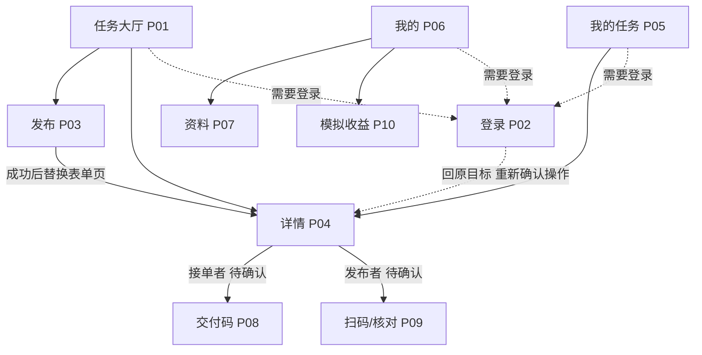

# S02 页面设计与交互规范

版本：1.1 · 2026-11-14。依据前端计划v0.3、最新需求v0.3和后端v0.6；替代1.0的预设地点及资料前置假设。

本阶段交付页面设计，不代表小程序已经实现。配套《S02-可点击页面草图.html》使用虚构数据，不连接后端、不扫码、不结算。草图中的按钮可用于走读路径；主工程仍保留 S01 原模板。后续改动按 S03 起依次落地。

## 1. 视觉与布局约定

面向在校园内找人代取、顺路接单的学生，优先看清“从哪取、送到哪、何时前、奖励多少、现在谁能操作”。采用轻量校园指示牌风格：清晰的取送路线、文字状态、少量绿色操作按钮；不放大面积宣传横幅或统计仪表盘。

| 用途 | 色值 | 使用方式 |
| --- | --- | --- |
| 主文字 | #17332D | 标题、路线、正文 |
| 主色 | #17634F | 主按钮、当前标签、路线起点 |
| 背景 | #F4F5EF | 页面背景；内容区白色 |
| 次文字 | #576C63 | 时间、说明、辅助标签 |
| 提醒 | #8A4A17 | 超时、结果待确认，配文字 |
| 危险 | #A63732 | 取消/关闭说明、失败文字 |

字体使用系统中文无衬线。页面标题20px/粗体，主要内容16px，辅助信息14px，不把重要内容压成小字。基准间距8/12/16/24px，页面两侧16px；触控区域至少44px。圆角适量，仅用于分组与按钮；不使用装饰性渐变、无意义图表和多层套卡片。

以375px宽手机设计，同时检查320px、390px、430px。正文自然换行；大厅标题至多两行，完整描述在详情展示。操作区留安全区及等高占位，长页面内容不被底栏遮住。状态不能只靠颜色区分；错误提示可被读屏读取；动效服从减少动态效果设置。

## 2. 三标签与十页路由

三个底部标签：任务大厅、我的任务、我的。发布使用大厅的“发布任务”按钮进入普通页，不占第四个标签。

| ID | 页面/路径 | 入口与返回 | 主要内容/完成后去向 |
| --- | --- | --- | --- |
| P01 | 任务大厅 `pages/index/index` | 默认首页；底部标签 | 类型筛选、待接单列表、下拉刷新、分页、发布按钮；点任务进P04 |
| P02 | 登录 `pages/login/index` | 未登录访问受保护操作 | 登录说明、微信登录、失败重试；成功回原任务/目标页，不自动执行接单等写操作 |
| P03 | 发布 `pages/publish/index` | P01发布按钮；返回大厅 | 标题、类型、自由取送地点、最晚送达时间、模拟奖励、选填公开说明；必填本次手机号、选填微信号/私密说明；明确成功redirectTo详情 |
| P04 | 详情 `pages/task-detail/index?taskId=…` | 大厅/我的任务；返回原列表 | 状态、路线、奖励、描述、时间线、允许的联系方式、身份相关底部操作 |
| P05 | 我的任务 `pages/my-tasks/index` | 底部标签 | 我发布的/我承接的、状态筛选、分页、刷新；进P04再原路返回 |
| P06 | 我的 `pages/profile/index` | 底部标签 | 当前账号、资料状态、资料/模拟收益入口、退出；未登录显示登录入口 |
| P07 | 资料 `pages/profile-edit/index` | P06 | 可选资料编辑待接口；不是发布/接单前置，修改不改变旧任务联系方式 |
| P08 | 交付码 `pages/delivery-code/index?taskId=…` | P04接单者、待确认 | 服务端凭据、有效期、刷新/重查；过期停止显示旧凭据；返回P04重查 |
| P09 | 扫码核对 `pages/scan-confirm/index?taskId=…` | P04发布者、待确认发起扫码 | 只读核验后显示任务摘要并确认；仅在只读核验接口存在时使用该分支 |
| P10 | 模拟收益 `pages/earnings/index` | P06 | 模拟累计、已结算任务记录、分页；空态说明、返回我的 |

路径是前端内部约定，不是已确定的后端API。标签页用switchTab，普通页用navigateTo；标签页不携带URL参数。详情仅传taskId；返回不存在上一页时switchTab回大厅。我的任务筛选保存在页面状态，不借标签URL传参。登录只恢复有效且在白名单内的目标，不接受任意URL。



## 3. 十页线框

线框定义信息优先级，实际小程序使用原生导航栏与tabBar。草图外面的“页面/角色/状态”控件只帮助审阅设计，不进入产品。

```text
P01 任务大厅                 P02 登录
校园互助 · 发布任务          返回 | 登录
[全部][取快递][代买][其他]    说明登录目的及必要信息
任务标题          ¥模拟奖励  [微信登录]
取 ● 自由填写地点            [暂不登录/返回]
送 └ 自由填写地点            登录失败就地重试
截止时间 · 待接单            成功回原目标，写操作再确认
列表加载/分页/空态
[大厅] [我的任务] [我的]

P03 发布                    P04 详情
返回 | 发布任务              返回 | 任务详情
类型、标题                  状态 · 身份/资格说明
描述（不支持图片）           标题          ¥模拟奖励
取件地点、送达地点           取 ● 地点 → 送 地点
截止时间、模拟奖励           截止、说明、必要联系方式
字段旁错误                  服务端进度时间线
模拟结算说明                错误/关闭原因/结果待确认
[发布任务] 提交中防连点      [本身份与当前状态允许的操作]

P05 我的任务                P06 我的
[我发布的][我承接的]         未登录入口 / 当前账号
[全部状态 v]                资料完成情况、账号状态
任务标题、状态、路线         > 个人资料
截止时间、模拟奖励           > 模拟收益（非真实余额）
空态提供去发布/大厅入口      [退出登录] 二次确认
[大厅] [我的任务] [我的]     [大厅] [我的任务] [我的]

P07 个人资料                P08 交付码
返回 | 个人资料              返回 | 交付码
已知资料、待确认的必要字段   当前任务及送达地点
字段用途/可见范围说明        [真实凭据展示区域]
字段旁错误                  以服务端为准的剩余有效期
[保存资料]                  失效时清除码，[刷新交付码]
保存中禁止重复提交          任务已关闭/完成则停止展示

P09 扫码核对                P10 模拟收益
返回 | 核对交付              返回 | 模拟收益
服务端核验的任务/参与人      “仅模拟结算，不涉及真实支付”
当前任务与扫描任务一致       模拟累计金额
“确认后任务完成”            已结算任务、金额、时间
[确认完成][取消返回]         空态、加载失败重试、分页
成功后回详情并重查           不提供充值、提现、钱包入口
```

P03公开区含类型、标题、自由地点、最晚送达时间、奖励（暂定>0且最多两位小数）、选填普通说明；私密区含必填本次手机号、选填微信号和私密交接说明。提示房间/取件码勿写公开区域；不做短信认证。类型草案为快递帮取、外卖帮取、资料帮取、轻量搬运、其他，编码/长度/金额上限/手机号细则以契约为准。接单在详情填写或确认本次手机号与选填微信号。无需先编辑P07；任务快照不随个人资料修改，结束默认隐藏完整号码，历史私密说明待定。草图全为样例。

## 4. 身份、状态与按钮矩阵

同一学生在不同任务中身份不同，按当前taskId判定，不能全局选定“我是跑腿员”。先加载详情，再取关系、状态、账号资格及后端允许动作；加载失败不显示可提交按钮。前端只控制展示，后端仍必须鉴权。

| 服务端状态 | 发布者 | 接单者 | 其他符合资格的学生 |
| --- | --- | --- | --- |
| 待接单 | 取消任务（二次确认） | 不存在该关系 | 接单（二次确认） |
| 已接单 | 只读查看进度 | 确认已取件（二次确认） | 允许查看时只读 |
| 已取件 | 只读查看进度 | 申请交付（二次确认） | 允许查看时只读 |
| 待确认 | 扫码确认 | 展示交付码、按约定刷新 | 无交付操作 |
| 已完成 | 只读完成结果 | 完成结果、模拟收益入口 | 允许查看时只读 |
| 已取消/已过期 | 只读结束说明 | 有历史关系时只读 | 允许查看时只读 |
| 已关闭 | 关闭原因、关闭时间 | 关闭原因、关闭时间 | 允许查看时只读 |

通用刷新详情为只读操作。已超时作为“当前进度 + 已超时”显示，具体允许动作依后端规则，不能由前端自行改为已过期。管理员在独立Web操作关闭；学生小程序不出现关闭按钮。未领取任务不存在“接单者”，草图会纠正该无效组合。

### 资格覆盖与敏感操作

| 条件 | 页面处理 | 恢复方式 |
| --- | --- | --- |
| 未登录 | 不允许受保护写入；展示登录入口 | 保存原目标，登录后回到目标，重新确认写操作 |
| 个人资料未完善 | 不据此禁止发布/接单 | 在本次发布/接单表单填写交接信息；不自动执行写操作 |
| 账号禁用 | 显示服务端原因；按服务端权限开放行为 | 在途任务处理待确认，不能先写死全禁或全放行 |
| 正在提交 | 主按钮禁用、显示进行中 | 明确结果后解锁；网络超时进入待确认分支 |
| 接单结果未知 | 显示“接单结果待确认”，暂停该任务的新接单 | 使用原请求编号查原结果，再取最新详情 |
| 状态冲突/无权查看 | 提示原因，重查或回列表 | 以最新服务端结果重新计算按钮 |

不存在接自己任务、编辑已发布任务、已接单后学生主动取消、重复领取同一任务、真实支付/提现、聊天或上传图片入口。一个学生可以接多个不同任务，不因已有在途任务而全局禁止接单。联系方式按后端字段权限显示，不在大厅公开。

## 5. 关键路径与异常处理

### 发布 → 接单 → 交付

1. A在大厅进入发布，检查字段；点击提交后防连点。明确成功后用返回的taskId替换表单页，进入详情并刷新大厅缓存。
2. B打开A的待接单任务，填写/确认本次手机号与选填微信号，再确认摘要提交。一次操作一个请求编号，超时复用；失败不写入交接关系、不开放私密信息；同编号输入一致性规则待F06。
3. 接单明确成功后重查详情；B确认取件，再申请交付；这两步只在服务端确认后推进。A看到最新进度，不使用B本地状态作为事实。
4. 待确认时B展示服务端短时交付码；A从自己任务的详情扫码。仅当服务端明确完成后展示已完成，收益再次查询模拟结算。

### 扫码两种接口分支

- 有只读核验接口：P04调扫码 → 验证基本格式 → 只读核验 → P09展示服务端任务摘要 → 用户点“确认完成” → 提交 → 回P04重查。
- 只有不可逆确认接口：P04先展示当前任务摘要和“扫码后将提交完成”的二次确认，再调用扫码并提交；跳过只读P09。不能为显示核对页而提前偷偷确认。
- 扫码取消只是返回，不报业务失败；无效、过期、不匹配、已使用等凭据按明确结果提示。原始扫码载荷只保留短时内存，不写URL、日志、存储；页面重建必须重新扫码。扫描内容不能直接决定taskId或跳往任意地址。
- 码到期只清除旧码并允许按契约刷新，不自动完成/失败任务；扫码提交超时先重查详情，恢复规则待接口确认。

### 结果未知及恢复

| 情况 | 前端动作 | 禁止推断 |
| --- | --- | --- |
| 接单超时/断网 | 保留按账号和任务绑定的原请求编号；提示查原结果 | 不能断言失败或立即换编号重接 |
| 原结果暂查不到 | 继续待确认，按约定重查或人工处理入口 | 查不到不等于业务失败 |
| 找到明确结果 | 展示原操作结果；再查最新详情 | 旧成功响应不能覆盖后来的已关闭状态 |
| 发布超时 | 保留表单，提示结果待确认，暂停重复发布 | 无幂等/恢复契约时不能自动补发 |
| 取件/交付/确认超时 | 重查详情并说明是否已确认；不能判定则保持待确认 | 不以按钮点击或本地动画推进进度 |
| WebSocket提示更新 | 请求最新详情/列表；回前台及重连也主动重查 | 不假定断线消息会补发、不按事件盲写最终状态 |

账号切换清空旧账号页面数据和码，旧响应不能改新账号页面；待确认接单记录按账号隔离保留。恢复和退出细则在S06/S17中落实。

### 页面共用状态

加载显示占位及“正在加载”；空列表说明原因并提供一个相关入口；失败保留筛选并提供重试；分页失败只重试该页，不能把旧内容当成空列表；刷新替换列表，加载更多按taskId去重。写操作业务失败要显示具体原因；网络不确定使用“结果待确认”。任务已关闭时详情展示原因、停止取件/扫码/交付，不生成模拟结算。

## 6. 未定契约（在S08逐项确认）

以下问题不阻止S03页面骨架和Mock；不按草图擅自认定后端已有能力。

| 对应能力 | 必须确认 | 临时实施方式 |
| --- | --- | --- |
| F01/F02 | 已有code登录/me及Bearer默认1小时；真实微信、响应结构仍待核对；资料编辑后置 | S03不调用登录；Mock身份不当正式鉴权；禁用在途待定 |
| F03/F05 | 类型编码、自由地点长度、公私字段、手机号、金额/时间及发布恢复 | 无地点字典；公开说明/微信号/私密说明选填；发布未知停重发 |
| F04 | 过滤、分页、可见范围、状态枚举、联系方式和允许动作 | 中文内部状态、独立适配层，不发明网络编码 |
| F06 | 接单请求编号格式、幂等窗口、查原结果与未知状态 | 同次操作复用原编号；查不到仍待确认 |
| F05/F07/F08 | 取消、取件、申请交付、操作幂等和冲突响应 | 重查服务端详情，写请求不通用自动重试 |
| F08/F09 | 码格式、有效期、只读核验、确认幂等、重复扫码及超时恢复 | 两分支设计；不生成可冒充真实凭据的本地码 |
| F10/F11/F12/F13 | 模拟结算字段、关闭与超时规则、WebSocket鉴权及事件、账号禁用处理 | 收到事件只触发重查；禁用/关闭具体权限待定 |

能力编号以执行表“接口待确认”的正式名称为准；本表按相关问题聚合，不新增后端承诺。

## 7. S02设计验收与后续实施

| 走读项 | 设计结论 | 证据边界 |
| --- | --- | --- |
| 三标签与十页可找到 | 页面选择器可审阅全部；标签与入口覆盖主路径 | 浏览器草图，不是小程序运行 |
| 大厅→发布→详情；我的任务→详情→返回 | 草图可点击走读；发布成功应替换表单页 | 假数据跳转，不执行发布 |
| 自己任务不可接、他人待领取可接 | 身份/状态矩阵与草图一致 | 实际后端鉴权待联调 |
| 取件→申请交付→展示码；发布者扫码 | 按状态分配按钮；扫码保留双接口分支 | 没有真实扫码、交付或收益 |
| 关闭/取消/过期为只读 | 原因/说明与刷新入口，无继续推进按钮 | 服务端关闭和并发冲突待联调 |
| 接单结果未知 | 独立提示与恢复入口，不展示假成功 | 原请求恢复将在S17实现 |

S02完成标准为规格与草图走读通过，可将设计任务标为“验收通过”。V01/V05/V08/V12等整体验收脚本仍待代码实现后运行，不能据此记成业务通过。

后续S03：在主工程处理写入能力后，整理Hello World模板、注册十页和三标签、集中配置Mock/real；先让各页有内容、有入口、有返回。S04做组件和样式；S05起做服务和业务逻辑。管理端归属不影响此主线。

变更记录（2026-11-14）：先前暂停已由用户“修改计划后继续S03”解除。依据新文件修订为1.1，公私隔离必须检查服务端响应本身；三A先发布/大厅/详情，取消/我的任务与接单随后，不能把已实现身份模块等同任务已完成。
