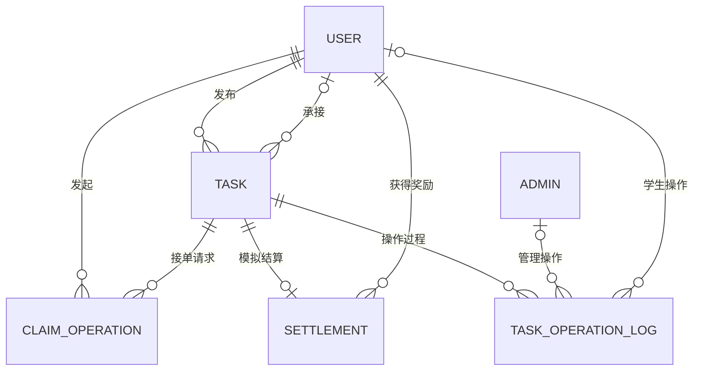
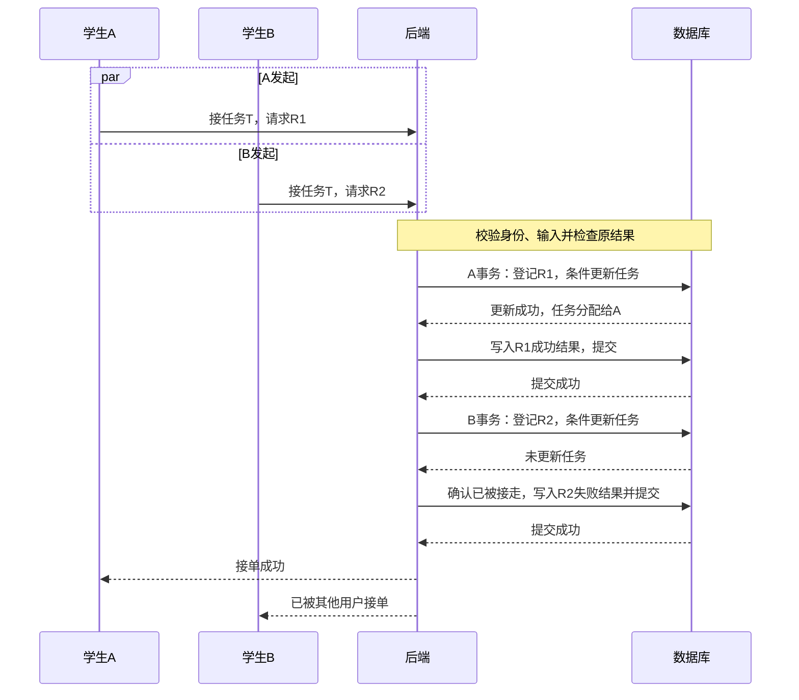
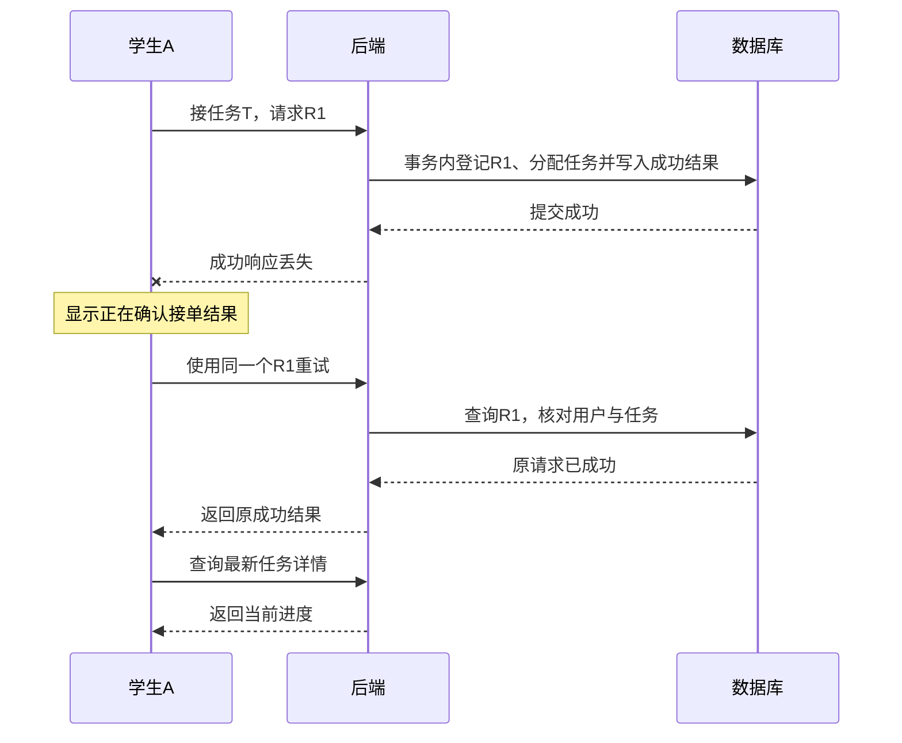

# 校园互助跑腿系统后端设计计划

- 版本：v0.11
- 创建日期：2026-10-22
- 更新日期：2026-11-19
- 当前状态：0.6 已实现确认取件、双方取消和客服审核，交付码、扫码完成及模拟结算为后续阶段。真实微信与小程序联调待进行。
- 需求依据：[校园互助跑腿系统需求说明](./校园互助跑腿系统需求说明.md)
- 开题依据：同目录《校园互助跑腿项目开题计划.docx》

## 1 文档目的

先明确后端设计的顺序、每一步需要解决的问题、应形成的结果和完成标准，再逐步开展设计，保留需求到设计的推导依据。

本文首先是一份设计计划。后续讨论形成的结论、理由和待定问题记录在本文对应阶段；详细表结构、接口契约或流程图较长时，可以另建专题文档并从本文链接。

尚未确认的字段、接口、数据库约束、事务方案和管理员处理规则，不因出现在计划中就视为最终设计。已实现范围和实际验证分别记录在第 12、13、15 节，不将计划条目直接视为完成证据。

## 2 当前需求与设计起点

### 2.1 已确定的需求范围

- 以课程答辩和多账号演示为主。
- 学生端为微信小程序，需要独立的管理员 Web 后台，共用业务后端。
- 所有学生都能发布任务和接他人的任务，不能接自己的任务。
- 每条任务最多一名接单者，同一学生可以同时承接不同任务。
- 发布后的任务不直接修改，通过未接单取消、重新发布调整内容。
- 取件地点和送达地点自由填写，不维护预设校园点位库；第三部分 A 不包含地图、自动距离计算或路线规划。
- 双方手机号必填、微信号选填，按任务保存；公开内容与私密交接说明分开，接单成功后双方可查看本次交接信息。
- 暂不做图片上传和站内聊天。
- 不做钱包和真实支付，保留奖励金额、模拟结算记录和模拟收益统计。
- 正常流程为：待接单 → 已接单 → 已取件 → 待确认 → 已完成。
- 并发抢单、重复请求、扫码确认与断线恢复是核心验证内容。

### 2.2 暂定规则与待细化项

需求文档中的截止时间、取消、过期和已接单超时处理沿用暂定方案，设计时需检查其边界。

管理员关闭进行中任务的基本规则见 5.4。仍待定：学生账号禁用后在途任务的处理、完整状态权限表，以及管理员关闭与学生操作同时发生时的处理。二维码时效、请求编号规则和分页等在对应模块细化。管理员账号的禁用检查已在第一轮实现，不能据此视为学生账号禁用规则也已确定。

### 2.3 开题报告中的技术基线

Spring Boot 单体、MyBatis、MySQL InnoDB、Redis 列表缓存、HTTPS 和 Spring WebSocket。

报告提出通过数据库事务、条件更新与操作结果记录保障抢单及重试结果；任务变更提交后刷新缓存并提醒客户端查询。设计阶段需要明确这些步骤之间的关系和失败处理。

已实现的身份模块数据与接口见第 12、13 节，任务基础接口见第 15 节。后续任务操作的数据与契约、后台前端技术栈和具体部署配置继续确定。

## 3 推进方式与记录规则

每次聚焦一个可以确认的小问题，按照以下顺序推进：

1. 明确业务目标，以及关联的页面、用户和输入。
2. 描述操作如何交给后端，由哪个模块接收，下一步交给谁。
3. 覆盖正常结果、重复操作、无权限、状态不符和网络异常等分支。
4. 比较必要的方案，说明选择理由及适用范围。
5. 确认结论并记录，保留未解决问题，再进入依赖它的下一步。

当前细化程度：先确定整体结构、模块职责、关键业务规则、正常流程和核心数据关系。字段类型、索引、SQL、错误码、超时参数及完整异常分支，在开发相应模块前再展开。前期已经记录的抢单细节保留作参考，不要求其他模块现在达到同样深度。

规则：

- 区分已确认、暂定、待定和已替代的结论。
- 涉及需求变化时，先说明对原规则的影响；经确认后同步需求文档。
- 勾选完成表示设计已形成并确认，不代表代码完成或实验通过。
- 尚未实现的预期效果不能记录为已有测试证据。
- 不确定项只阻塞依赖它的部分，其他独立内容可以继续设计。

## 4 阶段一 业务模块与职责

### 4.1 要解决的问题

- 学生端和管理端分别由哪些业务入口提供能力？
- 用户、任务、抢单、交付、模拟结算和管理追踪分别负责什么？
- 一次跨模块操作由谁协调，最终修改哪些业务数据？
- 缓存、通知和操作记录分别在何时参与？

### 4.2 已确认的模块职责

| 候选模块  | 职责起点               | 需要明确的边界       |
| ----- | ------------------ | ------------- |
| 用户与身份 | 登录、用户资料、账号状态与身份校验  | 学生与管理员身份如何识别  |
| 任务    | 发布、浏览、取消、过期判断、取件进度 | 与抢单和交付模块如何分工  |
| 抢单    | 并发接单、请求编号和结果查询     | 与任务归属更新如何协调   |
| 交付    | 申请交付、二维码与扫码确认      | 如何触发完成及模拟结算   |
| 模拟结算  | 记录奖励结算、统计模拟收益      | 如何避免重复结算      |
| 管理与追踪 | 后台查询、异常处理与操作记录     | 如何复用规则并保留处理依据 |

上述六个模块作为已确认的职责划分，在同一个 Spring Boot 应用内协作，不要求分别部署服务；具体代码包结构后续确定。

已确认的边界：

- 用户与身份模块提供可信的操作者身份；某个用户是否有权操作具体任务，还要结合任务关系与状态判断。
- 任务模块统一维护任务归属与状态转换规则，其他模块不能绕过规则任意修改状态。
- 抢单模块协调请求去重、竞争接单和操作结果保存，任务分配与结果记录共同保证正确性。
- 交付模块负责二维码与确认过程，并协调任务完成与模拟结算；具体交接和事务方案尚未展开。
- 模拟结算模块维护任务的有效结算记录，收益统计以此为依据，同一任务不能重复结算。
- 管理员使用独立操作入口，但仍须遵守明确的业务规则；异常处理需保留处理依据，不能任意更换接单者或修改状态。
- 缓存与通知作为业务流程使用的基础能力，具体调用与恢复方式继续设计。

### 4.3 产出与完成标准

- 产出：模块职责表、一次正常任务流程的模块调用关系。
- 完成标准：每个核心操作有明确接收者、协调者和数据归属，没有相互矛盾的职责。
- 状态：进行中，模块职责与发布流程已确认，完整流程调用关系尚未全部完成。
- 设计结论：见 4.2、4.4 和第 11 节。

### 4.4 已确认的发布流程

| 步骤 | 处理方 | 输入与结果 |
| --- | --- | --- |
| 识别操作者 | 身份校验能力 | 从登录凭据识别发布者，确认其具备当前操作资格 |
| 接收发布请求 | 任务模块发布入口 | 接收标题、地点、时间、奖励和说明 |
| 校验发布规则 | 任务模块 | 检查必填项、地点、送达时间与金额 |
| 保存任务 | 任务模块协调数据库操作 | 记录发布者、待接单状态，生成任务编号 |
| 更新相关缓存 | 缓存能力 | 数据库提交后使后续列表查询能够刷新 |
| 返回结果 | 发布接口 | 返回任务编号，小程序据此进入详情 |

规则：发布者身份来自可信登录结果，不能接受客户端任意指定他人作为发布者；数据库提交后任务才算发布成功。提交后的缓存处理失败不能把已经存在的任务解释为发布失败，缓存恢复机制待设计。

待定：发布响应丢失后的找回方式、发布操作是否也需要请求编号与防重复机制。抢单已确认的机制不自动视为发布机制。

### 4.5 正常流程的基础交接

| 用户操作 | 主要负责模块 | 协作模块 |
| --- | --- | --- |
| 登录、维护资料 | 用户与身份 | — |
| 发布、浏览、取消 | 任务 | 用户与身份提供可信操作者信息 |
| 接单 | 抢单 | 任务 |
| 确认已取件 | 任务 | — |
| 申请交付、扫码确认 | 交付 | 任务、模拟结算 |
| 查询模拟收益 | 模拟结算 | — |
| 后台查询、异常处理 | 管理与追踪 | 对应业务模块 |

此处只确定基础交接，不展开具体调用方法和事务实现。

## 5 阶段二 状态与操作权限

### 5.1 要解决的问题

- 每种状态允许发布者、接单者、其他学生和管理员执行哪些操作？
- 已取消、已过期如何表达，已超时标记如何与实际进度共存？
- 抢单与取消、抢单与过期判断同时发生时，如何决定有效结果？
- 重复取件、重复申请交付、重复扫码分别返回什么？
- 管理员可以关闭哪些任务，关闭后双方看到什么，是否影响结算？
- 用户被禁用后，登录、新操作和已有任务如何处理？

管理员异常处理可能影响状态设计，应在确定最终表结构前明确。暂不默认允许任意改状态、更换接单者或重新开放任务。

### 5.2 状态权限表模板

| 当前状态 | 操作  | 操作人及权限 | 前置条件 | 成功后的状态 | 重复或失败结果 | 关联记录与通知 |
| ---- | --- | ------ | ---- | ------ | ------- | ------- |
| 待填写  | 待填写 | 待填写    | 待填写  | 待填写    | 待填写     | 待填写     |
|      |     |        |      |        |         |         |

### 5.3 产出与完成标准

- 产出：完整状态转换表、角色权限表、管理员异常处理规则。
- 完成标准：正常路径、取消过期、越权跳步、重复操作和管理员处理均有明确结果。
- 状态：部分形成，管理员关闭任务和基础状态分类已记录，完整权限表后续补充。
- 设计结论：见 5.4，账号禁用规则仍为建议。

### 5.4 管理员关闭任务与基础状态

已确认管理员可以关闭进行中任务，范围包括待接单、已接单、已取件和待确认；第一版直接处理，不设置审批流程。

基本处理规则：填写原因或情况说明；关闭后标记为已关闭，与学生主动取消区分；双方能看到关闭结果与原因，不再继续推进；关闭不触发奖励结算；保留处理管理员、时间、原因和关闭前状态。

本节描述管理员主动关闭的权限。已取件后双方同意的取消申请由同一管理员角色兼任客服审核，审核流程见第 18 节。

状态分类：

- 正常流程：待接单 → 已接单 → 已取件 → 待确认 → 已完成。
- 其他结束方式：已取消、已过期、已关闭。
- 已超时：进行中任务的附加标记，保留实际进度。

建议已完成任务保留历史和结算，不提供撤销结算或手工改奖励；如需调整，后续再确认规则。状态编码及关闭与扫码等并发操作的处理留到对应模块设计。

账号禁用的建议方案：禁止发布和接收新任务，允许查看及处理已有任务，无法继续时由管理员关闭。该方案尚未单独确认。

## 6 阶段三 数据模型与数据库约束

### 6.1 要解决的问题

- 用户、任务、抢单操作结果、交付凭据、模拟结算、操作记录分别保存哪些信息？
- 哪些信息属于独立记录，哪些可以放在任务中，为什么？
- 哪些关系和唯一性需要数据库保障？
- 如何表示状态、请求归属、时间、奖励金额和取消或关闭原因？
- 如何支持任务大厅、我的任务、后台筛选及收益统计？
- 哪些字段需要索引、哪些数据需要保留历史？

不预先固定表数量。是否独立建表由查询、约束、生命周期和追踪需求决定。

### 6.2 表设计记录模板

每张表记录：用途、字段与类型、必填及默认值、主键与唯一约束、索引、关联关系、生命周期，以及对应的需求和查询。

### 6.3 产出与完成标准

- 产出：实体关系图、表结构说明、关键约束和索引依据。
- 完成标准：核心状态和操作结果可持久化，主要查询有数据来源，唯一性和金额表达明确。
- 状态：进行中，核心业务对象与逻辑关系已确认，物理表结构和字段尚未设计。
- 设计结论：见 6.4—6.6。

### 6.4 六类核心数据

| 业务对象 | 核心用途 |
| --- | --- |
| 用户 | 学生身份、个人资料、联系方式、账号状态 |
| 管理员 | 后台登录身份与账号状态 |
| 任务 | 发布者、接单者、任务内容、奖励、状态、阶段时间与关闭信息 |
| 接单操作 | 请求编号、操作者、目标任务和操作结果 |
| 模拟结算 | 任务、奖励接收者、金额与结算时间 |
| 任务操作记录 | 记录谁在何时对哪条任务执行了什么操作 |

上述是已确认的业务对象，不等于已经决定建立六张表。本轮管理员登录已采用独立的 admin_account 表，学生身份数据后续设计；交付二维码是否独立存储在交付模块设计时决定。

### 6.5 已确认的逻辑关系

| 关系 | 数量关系 | 说明 |
| --- | --- | --- |
| 用户 → 发布的任务 | 一对多 | 每条任务只有一个发布者 |
| 用户 → 承接的任务 | 一对多 | 每条任务最多一个接单者，未接单时为空 |
| 用户 → 接单操作 | 一对多 | 记录该用户的接单请求及结果 |
| 任务 → 接单操作 | 一对多 | 多个用户可分别发起接单请求 |
| 任务 → 模拟结算 | 一对零或一 | 正常完成前无结算，完成后最多一份有效结算 |
| 用户 → 模拟结算 | 一对多 | 一个用户可获得多笔模拟奖励 |
| 任务 → 任务操作记录 | 一对多 | 保存发布、接单、取件、交付、完成或关闭等过程 |



英文仅为对象代号，不是最终表名。每条任务操作记录对应一个实际操作人，学生与管理员两种操作人身份互斥；具体字段和数据库约束后续确定。

### 6.6 三项数据区分

- 接单操作记录不等于成功接单：失败请求也可有操作记录，实际接单关系看任务最终归属。
- 接单操作与任务操作记录用途不同：前者支持请求重试和并发实验，后者用于进度时间线与处理追踪。同编号重试不重复生成接单成功进度，失败抢单不必全部展示在学生时间线上。
- 任务奖励金额表达承诺奖励，模拟结算表达完成后给谁记录多少奖励。取消、过期、管理员关闭不生成奖励结算，收益依据结算记录汇总。

统计方案：第一版先从业务记录查询任务数量、状态数量和模拟收益，不单独维护统计数据。字段类型、索引和具体统计查询后续设计。

## 7 阶段四 接口与返回契约

### 7.1 要解决的问题

- 各页面需要哪些查询与操作接口，调用顺序是什么？
- 学生和管理员如何认证，服务端如何判断身份与权限？
- 发布、接单、取消、取件、交付、确认和后台处理分别需要什么输入？
- 抢单请求编号怎样生成、复用、绑定用户和查询结果？
- 如何区分业务失败、认证失败、服务异常和结果暂时未知？
- 列表如何分页筛选，详情向不同身份返回哪些信息？

### 7.2 接口记录模板

每个接口记录：用途、调用页面、方法与路径、身份要求、输入、前置状态、成功响应、失败响应、重复调用语义、状态变化、记录与通知。

### 7.3 产出与完成标准

- 产出：接口清单、核心请求响应示例、错误与重试约定。
- 完成标准：每个主要按钮和页面都有明确接口依据，客户端可判断下一步操作。
- 状态：待开展。
- 设计结论：待记录。

## 8 阶段五 核心流程与一致性

表与接口可以在本阶段检查后回调，不把前面设计视为不可修改。

### 8.1 并发抢单与重试

本节原有的即时确认流程保留为设计沿革。第四部分采用短确认窗口，具体约定以第 17 节为准。最终任务分配与成功结果同事务提交的原则继续保留。

本节记录已确认的处理原则。具体表结构、SQL、错误码、隔离级别和超时配置仍待设计；以下均为设计预期，不是已有实验结果。

#### 8.1.1 任务归属与请求结果

| 数据 | 回答的问题 | 示例 |
| --- | --- | --- |
| 任务记录 | 当前由谁接单，任务处于什么状态 | 任务 T 已接单，接单者为 A |
| 接单操作记录 | 某一次请求得到了什么业务结果 | R1 成功；R2 失败，任务已被其他用户接走 |

两类信息分别记录用途，物理表结构后续确定。一次接单请求编号在客户端发起操作时生成，超时重试继续使用原编号。编号必须绑定操作者和任务，绑定不符时拒绝编号复用。

任务归属回答当前事实，操作结果回答原请求是否成功。找回原结果后查询最新任务详情，避免用旧响应覆盖已经推进的任务进度。

#### 8.1.2 事务内先登记请求，再接单并补齐结果

```text
校验身份与输入
    ↓
查询原请求结果
    ├─ 已有结果：核对用户和任务，返回原业务结果
    └─ 无已提交结果：开始事务
                         ↓
                    登记请求编号（唯一约束）
                         ↓
                    对符合条件的任务执行接单更新
                         ↓
                    补齐确定的业务结果
                         ↓
                    提交事务
```

已确认原则：

- 不能仅依赖先查后写，因为同编号的并发调用可能都查不到结果。
- 请求登记、任务更新、操作结果保存处于同一个数据库事务。
- 成功分配任务与成功操作结果一起提交；事务内发生技术异常时整体回滚。
- 第一版不为请求占位单独提交一条长期存在的处理中记录，避免额外引入处理中记录的恢复流程。
- 不同请求竞争同一任务，通过条件更新保障最多一名接单者；未更新成功时需判断已接单、取消或过期等具体原因。
- 相同请求的重复到达，通过请求唯一约束与冲突处理保障不产生多份有效结果。
- 接单条件要覆盖状态、截止时间和本人发布限制，账号资格规则与具体条件表达待后续确定。
- 已被接走等确定业务失败可保存并返回原结果；临时数据库异常不应直接固化成永久业务失败。
- 成功提交后再处理相关缓存与通知；相关失败的恢复方式尚未确定。

#### 8.1.3 两个用户竞争同一任务

以下为 A 获胜的一种示意顺序，事务内登记请求步骤已纳入完整流程。



并发发起不表示同时完成写入。最终只保存一个接单者，R1、R2 各有对应的确定结果。

#### 8.1.4 成功响应丢失后的重试



找到原结果后不重新抢单。原成功响应可以返回多次，但仍然只有一次有效接单；实验统计必须区分成功响应次数与实际接单人数。

#### 8.1.5 原请求尚未结束时重复到达

| 原调用情况 | 重复调用的处理原则 |
| --- | --- |
| 已提交成功结果 | 核对绑定后返回原成功结果 |
| 已提交确定业务失败 | 返回原业务结果 |
| 尚未提交 | 不绕过请求唯一约束独立执行，在限定时间内等待或确认 |
| 已整体回滚 | 使用原编号重新尝试，仍需重新判断任务是否可接 |
| 限定时间内不能确认 | 返回结果待确认，保留原编号查询或重试 |

遇到请求唯一键冲突时，退出并回滚当前处理事务，再通过新的查询读取原结果。锁等待超时、死锁等技术情况单独处理，不能全部解释为任务已被其他人接走。

查不到已提交结果不等于确定失败，也不能单凭这一点断言原请求仍在处理中。原事务回滚后，任务也可能已被其他用户接走，重新尝试不保证成功。

客户端区分：明确成功、明确业务失败、结果待确认。只有得到明确结果后，才展示对应完成提示或失败原因。

#### 8.1.6 待细化清单

- 请求编号格式、唯一约束的具体键范围、保存期限与过期后的处理。
- 同用户使用新编号再次申请同一任务时的业务语义。
- 请求记录字段、最终结果分类、输入绑定方式和查询接口。
- 数据库隔离级别、条件更新 SQL、失败原因查询与事务调用方式。
- 锁等待与死锁处理、有限重试次数、等待时间和结果待确认响应契约。
- 取消、过期和账号禁用与接单竞争的完整规则。
- 提交后缓存及通知失败的恢复方式。

实现核对资料：[MySQL InnoDB 锁说明](https://dev.mysql.com/doc/refman/8.4/en/innodb-locks-set.html)、[死锁处理说明](https://dev.mysql.com/doc/refman/8.4/en/innodb-deadlocks-handling.html)。资料用于核对数据库行为，不表示具体实现版本已经选定。

### 8.2 交付与模拟结算

基础流程：接单者在已取件状态申请交付 → 任务待确认并展示二维码 → 发布者扫码 → 校验通过后任务完成并生成模拟结算 → 双方查看完成结果，接单者查看模拟奖励。

若任务有正在等待客服审核的取消申请，后端暂停申请交付、交付码生成或刷新、扫码确认及模拟结算，处理结果见第 18 节。

基础职责：交付模块协调申请与确认，任务模块维护进度，模拟结算模块生成有效结算并提供收益查询。

关键规则：仅接单者可申请交付，仅发布者可确认；二维码短时有效并绑定任务；完成与结算结果保持一致，不重复结算；完成前不计入模拟收益。

有效时长、凭据存储、刷新失效、事务实现及完整异常分支，在开发交付模块前再细化。

### 8.3 缓存与实时通知

- 明确数据库提交、缓存删除和通知的先后关系。
- 明确缓存删除失败、提醒丢失或延迟时如何恢复。
- 明确重连查询、列表刷新和结果未知提示的客户端配合。
- 明确日志如何关联请求、任务、操作人和结果，便于实验核对。

### 8.4 产出与完成标准

- 产出：关键流程图或时序图、事务边界、失败与恢复说明。
- 完成标准：每条流程能说明输入、接收者、成功结果、失败分支和最终数据依据。
- 状态：部分提前讨论，抢单处理原则和两类时序已确认；交付、缓存与完整恢复方案尚未完成。
- 设计结论：已确认部分见 8.1，8.2、8.3 继续讨论。

## 9 阶段六 开发顺序与验收计划

### 9.1 要解决的问题

- 先实现哪条可运行的业务流程，后续如何逐步增加并发保障和管理能力？
- 每阶段需要哪些账号、任务数据和运行环境？
- 哪些使用单元测试验证，哪些需要接口、数据库和多客户端联调？
- 如何构造并发、重复请求、响应丢失及连接断开？
- 如何记录环境、步骤、结果和数据库证据，使实验能够复现？

### 9.2 必须覆盖的验收主题

正常任务全流程；身份与状态校验；多人抢单；同编号重试；取消与抢单竞争；二维码与重复确认；模拟结算唯一性；缓存与断线恢复；管理员处理与操作追踪。

按开题报告进行 10、30、50 个近同时接单请求的实验，每组至少三轮，记录返回结果、最终归属、日志、错误分配和响应时间。

区分不同接单人数和重试响应次数。在任务初始可接、有效请求到达且服务正常时，预期恰有一人接单成功；普遍约束是同一任务最多一个接单者。

### 9.3 产出与完成标准

- 产出：开发里程碑、验收用例、实验步骤与结果记录格式。
- 完成标准：主要需求均有可执行验收方式，环境和数据前提明确。
- 状态：待开展。
- 设计结论：待记录。

## 10 设计进度

- [x] 整理本轮后端设计计划。
- [x] 确认六个模块职责与任务状态规则的归属。
- [x] 确认发布流程的模块交接。
- [x] 确认抢单的事务、请求唯一性及重试处理原则。
- [x] 记录不同用户竞争和响应丢失重试的时序图。
- [x] 形成正常任务流程的基础模块交接。
- [x] 确认管理员可关闭进行中任务及基本处理规则。
- [x] 确认六类核心数据与逻辑关系，记录关系图。
- [x] 完成管理员登录后端及用户手工验收。
- [x] 完成学生登录后端、隔离测试与 MySQL 结构校验。
- [x] 确认自由填写地点、双方任务联系方式及信息可见范围。
- [x] 确认第三部分 A 的发布、列表、详情范围和验收目标。
- [x] 确定第三部分 A 的任务必要字段及三个接口输入输出。
- [x] 实现第三部分 A，并完成自动化测试和独立 MySQL 验证。
- [x] 用户本机复跑第三部分 A 的 48 项任务隔离测试并反馈全部通过。
- [x] 细化并实现第三部分 B：我发布的任务、取消、待接单过期处理，完成自动化与独立 MySQL 验证。
- [ ] 用户验收第三部分 B 的 35 项隔离测试。
- [x] 实现第四部分的抢单、取消竞争、接单历史和请求重试，完成自动化测试和 MySQL 验证。
- [ ] 完成第四部分的使用者验收、真实小程序联调和 10/30/50 人并发实验。
- [x] 确认接单后双方取消、取件与客服审核的规则和接口，见第 18 节。
- [x] 实现并验证双方取消、取件与客服审核。
- [ ] 实现交付码、扫码完成与模拟结算，并接入客服审核的暂停规则。
- [ ] 配置真实小程序并完成微信登录及任务接口端到端联调。
- [ ] 阶段一：模块职责与调用关系确认。
- [ ] 阶段二：状态、权限和异常处理确认。
- [ ] 阶段三：数据模型、约束和索引确认。
- [ ] 阶段四：接口、返回与重试契约确认。
- [ ] 阶段五：核心流程、事务和恢复方案确认。
- [ ] 阶段六：开发与验收计划确认。

上述完整设计阶段仍未全部完成。身份模块实现与证据见第 12、13 节；任务 A/B 实施与验证见第 15、16 节。B 已自动验证，下一步由用户验收，再细化第四部分。真实微信登录及任务端到端流程待取得小程序配置后独立联调，不将隔离测试记为真实微信成功。

## 11 设计决策记录

本表记录实际确认过的后端设计，不将候选方案记为最终结论。

| 编号 | 日期 | 问题 | 确认结论 | 原因与影响 | 状态 |
| --- | --- | --- | --- | --- | --- |
| D001 | 2026-10-22 | 模块边界 | 六个业务模块在单体内协作，任务模块统一维护状态规则 | 避免规则分散，管理操作也须遵循规则，见 4.2 | 已确认 |
| D002 | 2026-10-22 | 发布流程 | 身份来自登录结果，任务模块协调校验和保存，提交后刷新相关缓存 | 提交后缓存异常不改变任务已发布的事实，见 4.4 | 已确认 |
| D003 | 2026-10-22 | 归属与请求结果 | 分别记录用途，成功分配与成功结果在同一事务提交 | 响应丢失后能够找回原结果，见 8.1.1—8.1.2 | 已确认 |
| D004 | 2026-10-22 | 重试与结果展示 | 同一次请求复用编号并绑定用户和任务，返回原结果后查询最新进度 | 防止重复操作及旧结果覆盖新进度，见 8.1.4 | 已确认 |
| D005 | 2026-10-22 | 同编号并发 | 事务内登记、即时确认接单并补齐结果 | 保留请求唯一约束及确认结果与任务同事务提交。短确认窗口中的申请改为先持久化，见第 17 节 | 即时确认方案已更新 |
| D006 | 2026-10-22 | 冲突与不确定结果 | 唯一键冲突后退出回滚当前处理事务，再新查询原结果；未确认时保留原编号 | 区分业务失败和技术异常，具体等待重试参数待定，见 8.1.5—8.1.6 | 已确认原则 |
| D007 | 2026-10-22 | 当前设计深度 | 先整体职责、关键规则、正常流程和数据关系，具体实现按模块再细化 | 保留已有抢单细节，不要求所有模块现在同样深入，见第 3 节 | 已确认 |
| D008 | 2026-10-22 | 管理员关闭任务 | 可关闭待接单、已接单、已取件和待确认任务，记录原因，关闭不结算 | 补齐课题演示中的异常处理，见 5.4 | 已确认基本规则 |
| D009 | 2026-10-22 | 核心数据模型 | 用户、管理员、任务、接单操作、模拟结算、任务操作记录六类对象及逻辑关系 | 业务对象不等于最终物理表，共表分表及二维码存储继续确定，见 6.4—6.6 | 已确认逻辑模型 |
| D010 | 2026-11-12 | 第一轮实现范围 | 基础工程、独立管理员账号、登录与当前管理员查询 | 按本轮开始实施授权完成，见第 12 节 | 已实现并验证 |
| D011 | 2026-11-12 | 管理员凭据 | 随机 Bearer 凭据，单体内存保存 1 小时，同账号重登替换旧凭据 | 实现取舍；重启需重新登录，配置与验证见 backend/README.md | 本轮实现方案 |
| D012 | 2026-11-13 | 学生登录实施范围 | 尚无小程序配置，先实现后端与隔离测试；正式接口接收微信 code | 用户明确选择该范围，真实微信联调独立标记待完成 | 已实现并隔离验证 |
| D013 | 2026-11-13 | 学生身份与凭据 | student_user 独立存储，AppID与OpenID共同唯一且区分大小写，学生与管理员凭据分域 | 客户端不能直接指定身份；共用凭据算法、分别保存状态 | 已实现并验证 |
| D014 | 2026-11-14 | 地点方案调整 | 取件与送达地点自由填写，私密位置细节放入交接说明 | 替代 2.1 中原预设点位方案，减少全校点位维护，见 14.2 | 第三部分 A 已实现 |
| D015 | 2026-11-14 | 双方交接信息 | 发布和接单时各填手机号、选填微信号，按任务保存；服务端按关系控制可见范围 | 不依赖个人资料最新值或前端隐藏，失败接单不建立交接关系，见 14.2—14.4 | 发布方已实现，接单方待第四部分 |
| D016 | 2026-11-14 | 第三部分 A | 仅任务发布、任务大厅列表和任务详情 | 先验证可发布、可查询及私密信息隔离，接口与验证见第 15 节 | 后端已实现并自动验证 |
| D017 | 2026-11-14 | 浏览认证与历史边界 | 三接口均要求学生登录；未结束任务仅发布者可读私密信息，结束态暂仅发布者可读公开历史 | 本轮实现默认值；接单者权限、管理员读取和数据清理在后续模块补充 | 已实现，后续可调整 |
| D018 | 2026-11-14 | 时间与查询精度 | 截止时间按 UTC 微秒存储；列表分页上限 100，仅查未过期待接单任务 | 对齐 MySQL DATETIME(6)，当前只计算过期展示、不写回状态 | 已实现并验证 |
| D019 | 2026-11-14 | 取消与重试 | 本人未到期待接任务可取消，重复取消返回原结果；行锁后取时，再条件更新 | 过期返回 409，专用异常保留已提交过期状态，见 16.2 | 已实现并验证 |
| D020 | 2026-11-14 | 持久化过期 | 启动和每 30 秒分批扫描，只转换到期 WAITING；读取继续计算有效状态 | 补充 D018 的持久化处理，状态筛选无需等待扫描，见 16.3 | 已实现并验证 |

后续方案调整时保留旧结论和替代关系，并在相关阶段同步更新，避免需求、表结构和接口互相矛盾。

## 12 第一轮实现与验证

实施日期：2026-11-12。工程目录：[backend](./backend/README.md)。

### 12.1 已完成范围

- Spring Boot 3.5.16 + MyBatis Starter 3.0.5 + MySQL 基础工程，提供 Maven Wrapper。
- 独立管理员表 admin_account，字段为 id、username、password_hash、display_name、enabled、created_at、updated_at；username 唯一。
- BCrypt 密码哈希与首次管理员初始化，已存在账号不重置密码。
- POST /api/admin/auth/login：登录与签发凭据。
- GET /api/admin/me：校验凭据和账号当前状态，返回公开资料。
- GET /api/health：执行数据库查询后返回健康结果。
- 管理路径身份拦截、输入校验、统一响应和异常反馈。

本轮单体内存保存管理员凭据，重启失效；每个管理员保留一个有效凭据，默认 1 小时过期。该实现不代表学生端登录方案已经确定。

### 12.2 本机数据库与账号准备

按用户本轮指示，新建 campus_errand 数据库，使用本机 root 连接，未修改其他库。连接密码与随机初始管理员密码仅保存在已被忽略的 backend/application-local.properties，不记录在共享文档中。

管理员账号为 admin，初始化已完成并关闭初始化开关。联调测试进程已经停止，启动方式和接口示例见 backend/README.md 与 backend/requests.http。

### 12.3 实际验证证据

- Maven clean package 成功，10 个测试通过，无失败或错误。
- 8 个 H2 隔离接口集成测试使用真实 MyBatis、BCrypt 和身份拦截，覆盖正常登录、身份查询、错误密码、未知账号、禁用、非法输入与重复登录等行为。
- 2 个凭据存储测试覆盖准确过期边界和不同管理员会话独立。
- 可执行 JAR 与真实 MySQL 8.0.46 完成健康、登录、资料查询、未登录拒绝和错误密码拒绝共 5 项 HTTP 验证。
- Maven Wrapper 已验证可运行，本机 Maven 3.9.11、Java 25.0.3。
- 报告在 backend/target/surefire-reports 和 backend/target/mysql-smoke-results.txt；构建 clean 会清除 target。

以上是第一轮管理员功能的验证记录。第二轮学生登录进度见第 13 节，任务基础接口见第 15 节；任务并发实验和后台页面尚未完成。

## 13 第二轮 学生登录后端与隔离测试

实施日期：2026-11-13。用户确认尚无小程序配置，先完成后端和隔离测试。详细说明：[学生登录说明](./backend/STUDENT_LOGIN.md)。

### 13.1 功能与数据

- POST /api/student/auth/wechat：接收 code，经后端调用微信获取身份，首次创建、再次复用学生账号，签发学生凭据。
- GET /api/student/me：查询当前学生公开资料。
- student_user 字段为 id、app_id、wechat_openid、nickname、contact、enabled、created_at、updated_at。
- AppID与OpenID共同唯一并区分大小写，首次默认昵称为微信用户、联系方式为空，资料编辑后续实现。
- 学生与管理员使用不同凭据存储，均暂用单体内存、默认 1 小时，同账号重登替换旧凭据。
- AppSecret 仅在服务端配置，session_key 不保存、不作为本系统凭据，不对外返回微信身份字段。
- 学生禁用后不能登录或查询身份；已有任务处理规则仍待定。

### 13.2 验证结果与边界

- Maven verify 成功，29 个测试通过：管理员原有 10 项、学生业务 9 项、微信 HTTP 适配 10 项。
- 学生业务测试使用模拟网关、真实业务代码与 H2；微信适配使用 HTTP 响应模拟，均不访问真实微信。
- 覆盖首次创建、同身份复用、四个不同临时 code 对同一身份并发登录、禁用、请求校验、身份域隔离，以及无效 code、网络响应错误和参数编码。
- 真实 MySQL 建表、健康检查、未配置微信的 503 及匿名查询的 401 验证通过；学生记录为 0，没有插入模拟业务账号。
- 独立端口验证后已停止临时进程，原 8080 服务未替换；新代码打包为 0.2.0-SNAPSHOT。
- 没有修改 Windows 或 IDEA 终端环境；构建只在独立进程选择 JDK25。

尚未完成：小程序侧 wx.login、真实 AppID/AppSecret 配置与临时 code 联调。当前正式服务未配置时返回 WECHAT_NOT_CONFIGURED，不宣称真实微信登录已通过。

## 14 第三部分 A 任务基础范围与信息边界

确认日期：2026-11-14。本节记录第三部分 A 的范围与关键规则，需求依据为需求说明第 3、4 节及 11.4。随后形成的具体接口、表结构与测试结果见第 15 节及任务专题文档。

### 14.1 范围与预期效果

本部分只实现发布任务、任务大厅列表、任务详情。

预期：学生 A 发布后取得任务编号，任务初始为待接单；学生 B 能在大厅和详情看到公开内容；A 查看自己的任务时能看到发布时保存的私密信息。

我发布的任务、取消和完整过期处理在第三部分 B 实现；抢单、接单方联系方式和我接单的任务在第四部分实现；取件、交付与模拟结算在第五部分实现；后台管理、通知与缓存在后续阶段补齐。

### 14.2 发布信息与可见范围

| 信息 | 是否必填 | 可见范围 |
| --- | --- | --- |
| 标题、类型 | 必填 | 公开 |
| 取件地点、送达地点 | 必填，自由文本 | 公开 |
| 最晚送达时间、奖励 | 必填 | 公开 |
| 普通任务说明 | 选填 | 公开 |
| 发布者手机号 | 必填 | 发布者本人、成功接单者 |
| 发布者微信号 | 选填 | 发布者本人、成功接单者 |
| 私密交接说明 | 选填 | 发布者本人、成功接单者 |

地点需足以判断任务区域，详细房间、取件码等放入私密交接说明。表单提示避免将联系方式和私密内容写入公开说明，但不把提示视为绝对防泄露保障。

“公开”表示可供已登录的学生任务浏览者查看；本轮三个接口均要求学生凭据，管理员凭据不能替代。

### 14.3 三类接口能力

| 能力 | 输入与处理原则 | 预期输出 |
| --- | --- | --- |
| 发布任务 | 提交任务表单；发布者由学生登录凭据取得；检查必填项、手机号、金额和时间 | 任务编号、初始状态等发布结果 |
| 大厅列表 | 分页、类型筛选、按发布时间排序，过滤不可接任务 | 仅公开的任务摘要，不返回联系方式或私密说明 |
| 任务详情 | 按任务编号查询，以实际登录身份判断与任务的关系 | 公开内容，以及符合关系与状态要求的私密信息 |

本部分没有接单能力，因此普通学生中只有发布者本人能够读取任务私密字段；接单者权限在抢单实现后开放。管理员敏感信息查询的具体接口在后台模块设计时明确。

### 14.4 交接信息保存与接单预留

- 发布时保存发布者手机号与选填微信号；不要求先实现个人资料编辑。
- 接单时由接单者填写或确认本次使用的手机号及选填微信号，成功后与任务关联。
- 本次交接信息按任务独立保存，个人资料以后可提供自动填充，但修改个人资料不应改变已有任务。
- 接单失败不向请求者开放私密字段，也不将失败请求的联系方式写为该任务接单者的联系方式。
- 联系方式及私密说明由服务端按身份、任务关系和状态决定是否返回，不能依赖客户端自称身份或仅隐藏界面。
- 列表及其未来共享缓存仅保存公开字段；日志保留必要操作追踪信息，避免记录完整联系方式、私密交接说明或 Token。
- 手机号做基本格式校验，第一版不接短信验证、不宣称已验证本人归属。
- 任务结束后当前默认仅发布者可查公开历史，不返回联系方式或私密说明，无关学生返回 404。接单者历史权限、管理员查询和数据保留清理规则后续细化。

### 14.5 验收与待定项

验收依据见需求说明 11.4，重点验证 A 发布后可查询、B 只能取得公开信息、A 可以查看自己未结束任务的完整内容，以及非法发布和越权读取被拒绝。任务模块已新增 48 项测试，全量共 77 项，实际验证见第 15 节。

字段名与类型、长度、基本联系方式格式、金额上限、分页和响应格式已在 [任务基础接口](./backend/TASK_API.md) 中记录。用户已复跑任务隔离测试；真实 HTTP 手工操作与小程序联调等待微信配置，第三部分 B 可继续细化；抢单、取消竞争和发布防重复仍需各自设计与验证。

本轮规则已同步需求说明，原开题报告保留为历史依据。

## 15 第三部分 A 实施与验证

实施日期：2026-11-14。专题说明：[任务基础接口](./backend/TASK_API.md)。当前版本为 0.3.0-SNAPSHOT。

### 15.1 接口与数据流

| 接口 | 实际行为 |
| --- | --- |
| POST /api/student/tasks | 从学生凭据取得发布者，校验表单，在事务中创建 WAITING 任务，返回编号和状态 |
| GET /api/student/tasks | 默认第 1 页、每页 20 条，上限 100，按类型筛选，按发布时间和编号降序；只返回未过期 WAITING 摘要 |
| GET /api/student/tasks/{id} | 以真实学生身份和任务状态过滤私密字段；发布者读取自己未结束任务时才返回 privateInfo |

调用关系：WebConfig 学生身份拦截 → TaskController → TaskService → TaskMapper → errand_task。数据库对象不直接作为接口响应，大厅 SQL 本身也不查询私密列。

errand_task 保存发布者、标题类型、自由文本取送地点、UTC 最晚送达时间、奖励、公开说明、发布方交接信息、私密说明、状态和创建更新时间。发布者外键关联 student_user，金额使用 DECIMAL(10,2)，大厅按状态和类型建立索引；实际定义见 backend/src/main/resources/schema-mysql.sql。暂不提前加入接单者、二维码或结算列。

截止时间须晚于当前时间，按微秒精度验证并保存。WAITING 到期后查询结果按 EXPIRED 处理、大厅过滤，但不在读取时写回状态；后续取消、抢单仍必须在写操作时重新检查数据库状态和截止时间。

### 15.2 实际验证证据

- Maven verify 成功，全量 77 项测试通过，无失败和错误；其中身份模块 29 项、任务模块 48 项。
- 任务测试覆盖发布与查询、分页排序、非法输入、A/B 私密字段隔离、伪造身份参数、禁用账号、管理员凭据隔离、过期边界和联系方式随任务保存。
- 同一任务测试类在独立临时 MySQL 库运行 48 项并通过，验证真实 MyBatis、外键、金额和时间存储；微信网关仍为模拟。临时库已删除。
- 2026-11-14 用户反馈：在本机复跑 48 项任务测试，全部通过。该记录为用户确认的隔离测试结果，不记为真实小程序或真实微信联调。
- 新可执行 JAR 在独立端口连接业务 MySQL 启动，健康检查及三个任务接口的匿名访问拒绝均通过。已创建 errand_task 表，检查时业务库学生记录和任务记录均为 0，未写入模拟业务数据。
- 验证进程已停止，原 8080 服务未替换。没有修改 Windows 或 IDEA 终端环境。
- 当前报告位于 backend/target/surefire-reports、backend/target/task-mysql-results.txt 和 backend/target/task-smoke-results.txt；clean 会清除这些产物，结论在本文留档。

以上证据不代表真实微信登录、真实小程序端到端流程或并发抢单实验通过。用户本机隔离测试已通过；真实学生 HTTP 操作等待微信配置和有效 code。

### 15.3 下一步与保留边界

原定第三部分 B 的我发布、取消和持久化过期处理已完成，设计与结果见第16节。后续第四部分实现接单、双方联系方式、竞争与请求重试；第五部分实现交付与模拟结算。

发布防重复、接单者历史权限、敏感信息保留清理和管理员敏感查询仍待细化。本轮没有开放指定学生身份的测试登录入口，也没有加入 Redis、WebSocket 或小程序页面。

## 16 第三部分 B 任务管理设计与实施

设计与实施日期：2026-11-14。用户授权后先记录以下约定，再完成代码与验证。当前结果见 16.5；专题说明见 [任务管理接口](./backend/TASK_MANAGEMENT.md)。

### 16.1 范围与接口

| 接口或能力 | 约定 |
| --- | --- |
| GET /api/student/tasks/mine | 查询当前学生发布的全部状态任务，page 默认 1、size 默认 20 且上限 100，status 选填，按 createdAt、id 降序 |
| POST /api/student/tasks/{id}/cancel | 当前发布者取消未接单且未过期任务；无需请求体，返回 id、status |
| 持久化过期 | 启动后及每次扫描将到期的 WAITING 改为 EXPIRED；不改变已接单或其他结束态 |

两个接口沿用现有学生认证和账号启用检查，不接受客户端指定操作人。mine 的分页与私密边界复用公开 Summary；结束态详情仍按第三部分 A 规则，不开放私密交接信息。

### 16.2 取消与并发边界

- 未登录或账号当前不可用返回 401；编号格式不合法返回 400；任务不存在或不属于本人返回 404 TASK_NOT_FOUND。
- 本人的 CANCELLED 重试返回 200 OK 和同一状态，保留原更新时间；即使截止时间后来经过，也不改成 EXPIRED。
- 本人的 WAITING 且 deadlineAt 晚于判断时间，条件更新为 CANCELLED。
- 本人的 WAITING 且 deadlineAt 小于等于判断时间，先持久化为 EXPIRED，返回 409 TASK_EXPIRED；本来已是 EXPIRED 的请求同样返回 409。
- 其他状态返回 409 TASK_STATE_CONFLICT，不支持学生直接取消已接单任务。
- 取消在事务中按编号和当前发布者执行锁定读取，取得行锁后再读取服务端 UTC 时间，再以发布者、原状态和截止时间作条件更新。这样等待行锁期间经过截止时间的请求也按到期处理。
- 专用 TaskExpiredException 表示过期状态已确认，事务仅对此异常不回滚；其他异常按默认规则回滚，避免把过期写入随 409 反馈一起撤销。

### 16.3 列表与过期扫描

- mine 按有效状态筛选：尚未写回的到期 WAITING 也应列入 EXPIRED，不列入 WAITING；总数、列表和展示使用同一次取时。
- 大厅和详情继续在读取时判断截止时间，不依赖定时扫描准时执行，不在 GET 请求中写数据库。
- 扫描默认启用、首次延迟 0、每轮完成后间隔 30 秒；每批最多 200 条，每轮最多 10 批，各批独立事务，避免一次长期持锁。
- 每条过期更新再次检查 WAITING 和截止时间，不能覆盖并发产生的 CANCELLED 或未来的 ACCEPTED。再次扫描不重复修改已有结束态。
- 后端重启后扫描所有到期待接任务，补处理停机期间到期的记录。测试配置关闭自动扫描，通过固定时钟主动触发，保证可重复验证。
- 复用 errand_task 原字段；本轮不新增接单、二维码、结算或操作记录表。当前索引用于课程规模，后续根据实际查询量再优化。

### 16.4 验证计划与后续边界

覆盖本人任务隔离、有效状态筛选、稳定分页与私密信息缺省、正常和重复取消、越权与非法状态、到期边界、等待行锁期间到期、并发重复取消、取消与扫描竞争、扫描批次及重启补偿。回归 A 和身份模块，并在独立临时 MySQL 库验证锁定与真实 SQL 行为。

取消与真实抢单的竞争留待第四部分联合验证，不能将本轮扫描竞争测试记为抢单实验。真实微信和小程序端到端联调仍待配置。

### 16.5 实施与验证记录

- 新增 TaskManagementIntegrationTest，35 项通过；Maven verify 全量 112 项通过，无失败或错误，生成 0.4.0-SNAPSHOT JAR。
- A 的 48 项与 B 的 35 项，共 83 项在独立临时 MySQL 库另行通过，包含行锁等待、并发重复取消、取消/扫描竞争和扫描不能覆盖随后提交的取消状态。临时库已删除。
- 新 JAR 在另一临时库验证扫描开关、匿名访问拒绝、重启补过期、未来和已取消记录保留、重复扫描不改写时间；使用真实定时执行，未模拟调度器。
- 只在临时库插入虚构数据，业务库学生与任务计数前后一致；验证进程和临时库已清理，原 8080 服务未替换，Windows/IDEA 终端环境保持原状。
- 当前报告为 backend/target/surefire-reports、backend/target/task-b-mysql-results.txt 与 backend/target/task-b-smoke-results.txt，clean 会清除这些产物。
- 用户 B 验收、真实微信、小程序端到端以及与真实抢单的竞争验证尚未完成。没有新增接单、交付、结算、Redis 或 WebSocket。

## 17 第四部分 接单确认、取消竞争与重试

### 17.1 确认窗口与顺序

- 第一笔有效申请持久化时开启默认 1 秒的确认窗口。后续申请沿用同一个截止点，重试不延长时间。申请时间由服务端在锁定任务后判断，登记顺序由数据库生成的申请序号确定。
- 窗口内，仍待接单且未到期的任务可由发布者直接取消，所有已受理的申请结束为任务已取消。到窗口关闭点后，发布者的直接取消先由后端结清该窗口，再按实际任务状态处理。
- 窗口关闭或任务到期后，后端在持有同一任务行锁时完成判断。任务已到期则按过期处理；否则把任务分给登记顺序最早且仍可用的学生。任务状态、接单归属、成功结果及本轮其他结果共同提交。
- 待确认申请保存在数据库。提交或重试可推动已结束窗口的确认，后台扫描负责处理没有后续请求的情况，并补处理重启前留下的申请。数据库事务只覆盖读写，不在事务中等待窗口。

### 17.2 接口、重试与可见范围

- POST /api/student/tasks/{id}/claim，学生提交 UUID requestId、runnerPhone、可选 runnerWechat。相同账号和编号绑定同一任务及标准化表单。首次受理返回 HTTP 202；结果确定后重试同一 POST 取得原结果。同账号新编号再次申请已经分给自己的任务，返回已接到，原联系方式保持不变。
- 接单归属表以任务编号为主键，保存成功接单者、确认时间和本次交接联系方式。申请表只在确认期间暂存表单，结清时清除原电话和微信号。保留输入摘要以核对重试，具体数据清理期限留待统一制定。
- GET /api/student/tasks/accepted 返回本人接单的任务摘要，可分页筛选。进行中的详情只有发布者和正式接单者可查看双方交接资料。结束后的历史详情向双方开放并省略私密信息。失败者仍按普通浏览者权限处理。

### 17.3 接单后取消与取件边界

- 正式接单后，任一方可以申请取消，由另一方确认。发起申请不会暂停任务。后端以同意操作受理时的已提交状态判断：未取件则取消，已取件则转客服。
- 接单者手动确认取件，后端保存状态和时间。先取消则拒绝取件，先取件则转客服。客服核实物品去向后可关闭任务，记录原因，关闭不结算。
- 第四部分先实现接单确认、既有直接取消的竞争边界、重试与接单者查询。双方取消、取件及客服审核的接口与竞争边界见第 18 节。

### 17.4 实施记录

2026-11-19 已实现并生成 0.5.0-SNAPSHOT JAR，接口契约见 [接单接口](./backend/TASK_CLAIM.md)。

- Maven verify 通过 123 项，新增 11 项抢单集成测试。A/B/抢单共 94 项任务用例在独立临时 MySQL 库通过。
- 在独立临时库预置已到确认时间的待处理申请，启动新 JAR 后自动结清，任务和请求均为已接单，仅生成一条归属，申请中的临时联系方式被清除。
- 测试使用模拟微信身份。S07 小程序联调、规模化并发实验、双方取消与真实取件的竞争待后续验证。

## 18 第五部分 确认取件与双方取消

本节记录 2026-11-19 确认的规则与接口，学生操作和管理员审核接口已在 0.6.0-SNAPSHOT 实现。

### 18.1 申请如何影响任务

| 操作 | 操作者及条件 | 结果 |
| --- | --- | --- |
| 确认取件 | 正式接单者，任务处于已接单 | 任务进入已取件，保存服务端确认时间。已成功确认的重试返回原取件时间 |
| 发起取消 | 发布者或正式接单者，任务处于已接单、已取件或待确认 | 建立一份待对方答复的申请，任务按原状态推进 |
| 撤回申请 | 原发起人，申请仍待对方答复 | 结束该申请，任务保持当前状态 |
| 继续任务 | 申请的另一方，申请仍待答复 | 拒绝申请，任务保持当前状态 |
| 同意取消，尚未确认取件 | 申请的另一方，任务仍为已接单 | 任务转为已取消，双方保留历史，不产生模拟结算 |
| 同意取消，已确认取件 | 申请的另一方，任务为已取件或待确认 | 申请进入待客服审核，任务保持原进度并暂停交付操作 |
| 审核通过 | 管理员，申请待客服审核，已核实物品去向 | 任务转为已关闭，记录审核人、时间与理由，不产生模拟结算 |
| 审核驳回 | 管理员，申请待客服审核 | 结束该申请，保留审核记录，从原进度恢复交付 |

「待对方答复」「取消审核中」由取消申请状态表达，任务继续使用已接单、已取件、待确认等原有状态。只有取消审核中才暂停申请交付、交付码生成或刷新、扫码确认和模拟结算。双方可以查看进度与审核结果。若任务在等待对方答复期间完成，该申请随任务完成而结束。

### 18.2 接口约定

| 接口 | 输入与反馈 |
| --- | --- |
| `POST /api/student/tasks/{id}/pickup` | 使用学生凭据，无需额外表单。成功返回 taskId、taskStatus、pickedUpAt |
| `POST /api/student/tasks/{id}/cancellations` | 使用学生凭据。提交本次申请的 UUID requestId，可备注原因。两人同时发起时返回先登记的申请 |
| `GET /api/student/tasks/{id}/cancellations/latest` | 发布者和接单者查看最近一次申请及处理结果。没有申请时 data 为 null。详情附带取消摘要和已确认的取件时间，供前端显示操作入口 |
| `POST /api/student/tasks/{id}/cancellations/{cancellationId}/actions` | 使用学生凭据。action 为 AGREE（同意）、DECLINE（继续任务）或 WITHDRAW（撤回）。按申请身份校验权限 |
| `GET /api/admin/task-cancellations?status=AWAITING_REVIEW` | 使用管理员凭据，分页查看待审核申请，提供任务进度、申请与答复信息。也可筛选 APPROVED 或 REJECTED，默认第 1 页、每页 20 条 |
| `POST /api/admin/task-cancellations/{cancellationId}/decision` | 使用管理员凭据。提交 APPROVE 或 REJECT，并填写处理原因。返回申请状态和任务状态 |

申请返回 cancellationId、taskId、status、taskStatus、requesterId、处理时间和 deliveryPaused。状态使用 AWAITING_PEER、AWAITING_REVIEW、WITHDRAWN、DECLINED、CANCELLED、APPROVED、REJECTED，未来的交付完成流程会使用 TASK_FINISHED。学生的详情和申请查询以服务端认证后的任务关系核验，只有两位当事学生可以读取。审核权限沿用独立的管理员身份。

参数错误返回 400，无凭据或凭据身份域不符返回 401。任务当事人使用不适用的角色操作时返回 403，无关学生查询取消信息返回 404。任务或申请状态不匹配返回 409。同一账号的 requestId 重试始终返回原来关联的申请，改用于另一任务返回 409。理由上限为 500 字符，审核理由必填。

### 18.3 并发与验收

- 每条任务最多一份待处理申请，包含待对方答复与待客服审核。后端以任务行锁串联创建、答复、取件、审核和未来的交付完成。先发起的一份由申请发起人与另一方明确处理，第二次发起不会自动同意。重试沿用原 requestId 或 cancellationId，不重复创建申请、关闭或结算。
- 同意取消与确认取件竞争时，若取消先提交，取件请求因状态不符被拒绝；若取件先提交，同意操作转客服。扫码完成与转客服也依同一任务状态判断。先完成的任务结束未决申请，先转审核的任务暂停扫码与结算。
- 审核结果与对应任务变更共同提交。审核驳回恢复当前任务阶段，交付码仍按原有效期规则判定。
- 实现后验证双方同时发起、明确同意、撤回和拒绝、角色隔离、重复操作、两种取件竞争顺序及审核通过和驳回。交付模块接入后增加审核暂停与扫码完成的竞争验证。

### 18.4 实施与验证

2026-11-19，Maven verify 通过 131 项，包含新增的 8 项取件与取消测试。任务相关的 102 项也在独立 MySQL 库通过。用旧结构和已有任务验证升级，原任务保留并新建取件、取消申请和请求编号关联表。

正式接单者可以确认取件，双方可以发起或处理取消申请，管理员可以查询并审核。审核中已返回 deliveryPaused，后续交付码、扫码和模拟结算接口须在取得任务行锁后根据待审核状态拒绝继续，待与交付模块一并验证。
