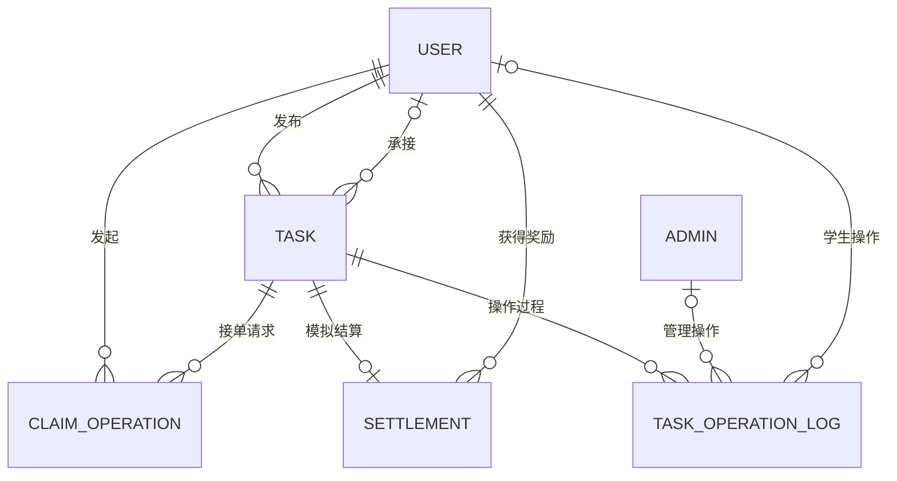
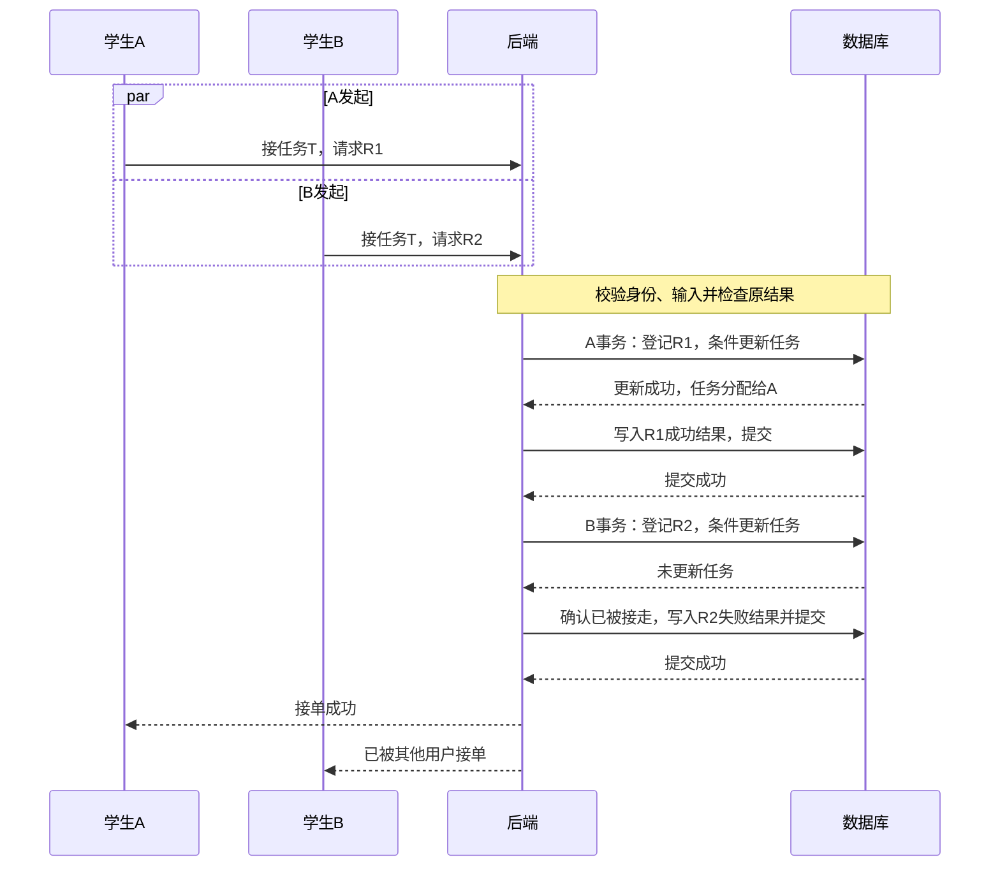
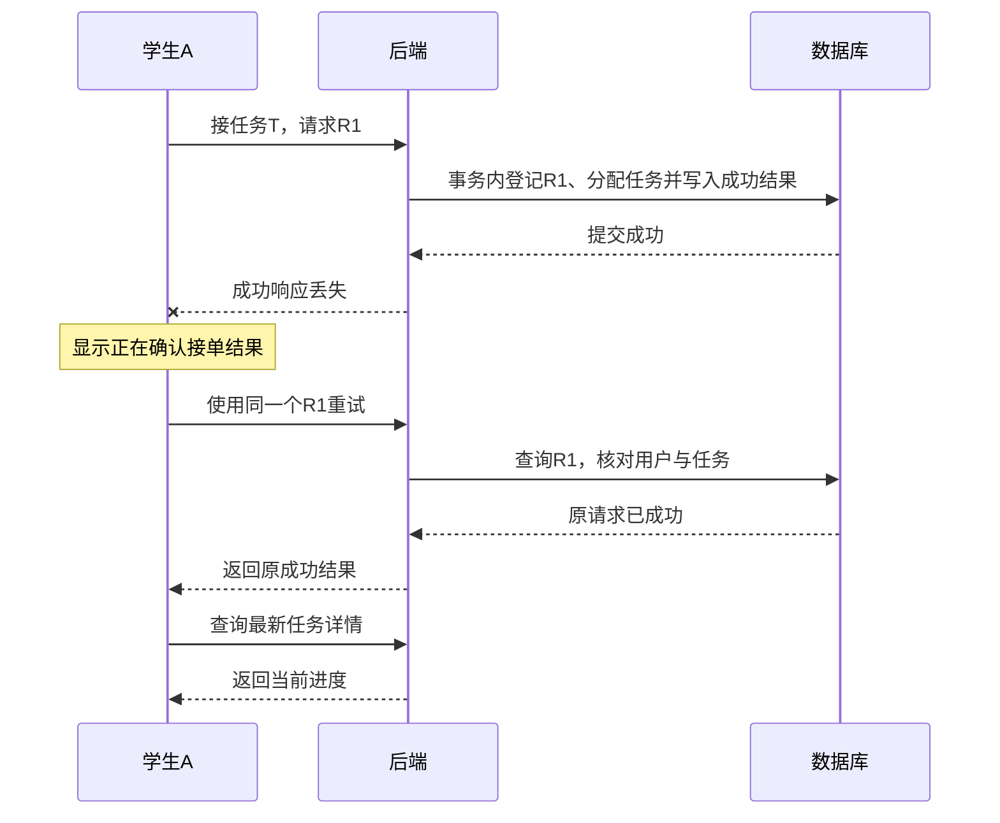

# 校园互助跑腿系统后端设计计划

- 版本：v0.6
- 创建日期：2026-10-22
- 更新日期：2026-11-14
- 当前状态：身份模块进度不变；第三部分 A 的地点、交接信息与验收范围已确认，任务字段和接口契约待设计，任务代码尚未实现
- 需求依据：[校园互助跑腿系统需求说明](./校园互助跑腿系统需求说明.md)
- 开题依据：同目录《校园互助跑腿项目开题计划.docx》

## 1 文档目的

先明确后端设计的顺序、每一步需要解决的问题、应形成的结果和完成标准，再逐步开展设计，保留需求到设计的推导依据。

本文首先是一份设计计划。后续讨论形成的结论、理由和待定问题记录在本文对应阶段；详细表结构、接口契约或流程图较长时，可以另建专题文档并从本文链接。

尚未确认的字段、接口、数据库约束、事务方案和管理员处理规则，不因出现在计划中就视为最终设计。本文也不表示后端已实现或通过测试。

## 2 当前需求与设计起点

### 2.1 已确定的需求范围

- 以课程答辩和多账号演示为主。
- 学生端为微信小程序，需要独立的管理员 Web 后台，共用业务后端。
- 所有学生都能发布任务和接他人的任务，不能接自己的任务。
- 每条任务最多一名接单者，同一学生可以同时承接不同任务。
- 发布后的任务不直接修改，通过未接单取消、重新发布调整内容。
- 取件地点和送达地点自由填写，不维护预设校园点位库；第三部分 A 不包含地图、自动距离计算或路线规划。
- 双方手机号必填、微信号选填，按任务保存；公开内容与私密交接说明分开，接单成功后双方可查看本次交接信息。
- 暂不做图片上传和站内聊天。
- 不做钱包和真实支付，保留奖励金额、模拟结算记录和模拟收益统计。
- 正常流程为：待接单 → 已接单 → 已取件 → 待确认 → 已完成。
- 并发抢单、重复请求、扫码确认与断线恢复是核心验证内容。

### 2.2 暂定规则与待细化项

需求文档中的截止时间、取消、过期和已接单超时处理沿用暂定方案，设计时需检查其边界。

管理员关闭进行中任务的基本规则见 5.4。仍待定：学生账号禁用后在途任务的处理、完整状态权限表，以及管理员关闭与学生操作同时发生时的处理。二维码时效、请求编号规则和分页等在对应模块细化。管理员账号的禁用检查已在第一轮实现，不能据此视为学生账号禁用规则也已确定。

### 2.3 开题报告中的技术基线

Spring Boot 单体、MyBatis、MySQL InnoDB、Redis 列表缓存、HTTPS 和 Spring WebSocket。

报告提出通过数据库事务、条件更新与操作结果记录保障抢单及重试结果；任务变更提交后刷新缓存并提醒客户端查询。设计阶段需要明确这些步骤之间的关系和失败处理。

已实现的身份模块数据与接口见第 12、13 节。后台前端技术栈、任务数据结构与接口契约、具体部署配置继续确定。

## 3 推进方式与记录规则

每次聚焦一个可以确认的小问题，按照以下顺序推进：

1. 明确业务目标，以及关联的页面、用户和输入。
2. 描述操作如何交给后端，由哪个模块接收，下一步交给谁。
3. 覆盖正常结果、重复操作、无权限、状态不符和网络异常等分支。
4. 比较必要的方案，说明选择理由及适用范围。
5. 确认结论并记录，保留未解决问题，再进入依赖它的下一步。

当前细化程度：先确定整体结构、模块职责、关键业务规则、正常流程和核心数据关系。字段类型、索引、SQL、错误码、超时参数及完整异常分支，在开发相应模块前再展开。前期已经记录的抢单细节保留作参考，不要求其他模块现在达到同样深度。

规则：

- 区分已确认、暂定、待定和已替代的结论。
- 涉及需求变化时，先说明对原规则的影响；经确认后同步需求文档。
- 勾选完成表示设计已形成并确认，不代表代码完成或实验通过。
- 尚未实现的预期效果不能记录为已有测试证据。
- 不确定项只阻塞依赖它的部分，其他独立内容可以继续设计。

## 4 阶段一 业务模块与职责

### 4.1 要解决的问题

- 学生端和管理端分别由哪些业务入口提供能力？
- 用户、任务、抢单、交付、模拟结算和管理追踪分别负责什么？
- 一次跨模块操作由谁协调，最终修改哪些业务数据？
- 缓存、通知和操作记录分别在何时参与？

### 4.2 已确认的模块职责

| 候选模块  | 职责起点               | 需要明确的边界       |
| ----- | ------------------ | ------------- |
| 用户与身份 | 登录、用户资料、账号状态与身份校验  | 学生与管理员身份如何识别  |
| 任务    | 发布、浏览、取消、过期判断、取件进度 | 与抢单和交付模块如何分工  |
| 抢单    | 并发接单、请求编号和结果查询     | 与任务归属更新如何协调   |
| 交付    | 申请交付、二维码与扫码确认      | 如何触发完成及模拟结算   |
| 模拟结算  | 记录奖励结算、统计模拟收益      | 如何避免重复结算      |
| 管理与追踪 | 后台查询、异常处理与操作记录     | 如何复用规则并保留处理依据 |

上述六个模块作为已确认的职责划分，在同一个 Spring Boot 应用内协作，不要求分别部署服务；具体代码包结构后续确定。

已确认的边界：

- 用户与身份模块提供可信的操作者身份；某个用户是否有权操作具体任务，还要结合任务关系与状态判断。
- 任务模块统一维护任务归属与状态转换规则，其他模块不能绕过规则任意修改状态。
- 抢单模块协调请求去重、竞争接单和操作结果保存，任务分配与结果记录共同保证正确性。
- 交付模块负责二维码与确认过程，并协调任务完成与模拟结算；具体交接和事务方案尚未展开。
- 模拟结算模块维护任务的有效结算记录，收益统计以此为依据，同一任务不能重复结算。
- 管理员使用独立操作入口，但仍须遵守明确的业务规则；异常处理需保留处理依据，不能任意更换接单者或修改状态。
- 缓存与通知作为业务流程使用的基础能力，具体调用与恢复方式继续设计。

### 4.3 产出与完成标准

- 产出：模块职责表、一次正常任务流程的模块调用关系。
- 完成标准：每个核心操作有明确接收者、协调者和数据归属，没有相互矛盾的职责。
- 状态：进行中，模块职责与发布流程已确认，完整流程调用关系尚未全部完成。
- 设计结论：见 4.2、4.4 和第 11 节。

### 4.4 已确认的发布流程

| 步骤 | 处理方 | 输入与结果 |
| --- | --- | --- |
| 识别操作者 | 身份校验能力 | 从登录凭据识别发布者，确认其具备当前操作资格 |
| 接收发布请求 | 任务模块发布入口 | 接收标题、地点、时间、奖励和说明 |
| 校验发布规则 | 任务模块 | 检查必填项、地点、送达时间与金额 |
| 保存任务 | 任务模块协调数据库操作 | 记录发布者、待接单状态，生成任务编号 |
| 更新相关缓存 | 缓存能力 | 数据库提交后使后续列表查询能够刷新 |
| 返回结果 | 发布接口 | 返回任务编号，小程序据此进入详情 |

规则：发布者身份来自可信登录结果，不能接受客户端任意指定他人作为发布者；数据库提交后任务才算发布成功。提交后的缓存处理失败不能把已经存在的任务解释为发布失败，缓存恢复机制待设计。

待定：发布响应丢失后的找回方式、发布操作是否也需要请求编号与防重复机制。抢单已确认的机制不自动视为发布机制。

### 4.5 正常流程的基础交接

| 用户操作 | 主要负责模块 | 协作模块 |
| --- | --- | --- |
| 登录、维护资料 | 用户与身份 | — |
| 发布、浏览、取消 | 任务 | 用户与身份提供可信操作者信息 |
| 接单 | 抢单 | 任务 |
| 确认已取件 | 任务 | — |
| 申请交付、扫码确认 | 交付 | 任务、模拟结算 |
| 查询模拟收益 | 模拟结算 | — |
| 后台查询、异常处理 | 管理与追踪 | 对应业务模块 |

此处只确定基础交接，不展开具体调用方法和事务实现。

## 5 阶段二 状态与操作权限

### 5.1 要解决的问题

- 每种状态允许发布者、接单者、其他学生和管理员执行哪些操作？
- 已取消、已过期如何表达，已超时标记如何与实际进度共存？
- 抢单与取消、抢单与过期判断同时发生时，如何决定有效结果？
- 重复取件、重复申请交付、重复扫码分别返回什么？
- 管理员可以关闭哪些任务，关闭后双方看到什么，是否影响结算？
- 用户被禁用后，登录、新操作和已有任务如何处理？

管理员异常处理可能影响状态设计，应在确定最终表结构前明确。暂不默认允许任意改状态、更换接单者或重新开放任务。

### 5.2 状态权限表模板

| 当前状态 | 操作  | 操作人及权限 | 前置条件 | 成功后的状态 | 重复或失败结果 | 关联记录与通知 |
| ---- | --- | ------ | ---- | ------ | ------- | ------- |
| 待填写  | 待填写 | 待填写    | 待填写  | 待填写    | 待填写     | 待填写     |
|      |     |        |      |        |         |         |

### 5.3 产出与完成标准

- 产出：完整状态转换表、角色权限表、管理员异常处理规则。
- 完成标准：正常路径、取消过期、越权跳步、重复操作和管理员处理均有明确结果。
- 状态：部分形成，管理员关闭任务和基础状态分类已记录，完整权限表后续补充。
- 设计结论：见 5.4，账号禁用规则仍为建议。

### 5.4 管理员关闭任务与基础状态

已确认管理员可以关闭进行中任务，范围包括待接单、已接单、已取件和待确认；第一版直接处理，不设置审批流程。

基本处理规则：填写原因或情况说明；关闭后标记为已关闭，与学生主动取消区分；双方能看到关闭结果与原因，不再继续推进；关闭不触发奖励结算；保留处理管理员、时间、原因和关闭前状态。

状态分类：

- 正常流程：待接单 → 已接单 → 已取件 → 待确认 → 已完成。
- 其他结束方式：已取消、已过期、已关闭。
- 已超时：进行中任务的附加标记，保留实际进度。

建议已完成任务保留历史和结算，不提供撤销结算或手工改奖励；如需调整，后续再确认规则。状态编码及关闭与扫码等并发操作的处理留到对应模块设计。

账号禁用的建议方案：禁止发布和接收新任务，允许查看及处理已有任务，无法继续时由管理员关闭。该方案尚未单独确认。

## 6 阶段三 数据模型与数据库约束

### 6.1 要解决的问题

- 用户、任务、抢单操作结果、交付凭据、模拟结算、操作记录分别保存哪些信息？
- 哪些信息属于独立记录，哪些可以放在任务中，为什么？
- 哪些关系和唯一性需要数据库保障？
- 如何表示状态、请求归属、时间、奖励金额和取消或关闭原因？
- 如何支持任务大厅、我的任务、后台筛选及收益统计？
- 哪些字段需要索引、哪些数据需要保留历史？

不预先固定表数量。是否独立建表由查询、约束、生命周期和追踪需求决定。

### 6.2 表设计记录模板

每张表记录：用途、字段与类型、必填及默认值、主键与唯一约束、索引、关联关系、生命周期，以及对应的需求和查询。

### 6.3 产出与完成标准

- 产出：实体关系图、表结构说明、关键约束和索引依据。
- 完成标准：核心状态和操作结果可持久化，主要查询有数据来源，唯一性和金额表达明确。
- 状态：进行中，核心业务对象与逻辑关系已确认，物理表结构和字段尚未设计。
- 设计结论：见 6.4—6.6。

### 6.4 六类核心数据

| 业务对象 | 核心用途 |
| --- | --- |
| 用户 | 学生身份、个人资料、联系方式、账号状态 |
| 管理员 | 后台登录身份与账号状态 |
| 任务 | 发布者、接单者、任务内容、奖励、状态、阶段时间与关闭信息 |
| 接单操作 | 请求编号、操作者、目标任务和操作结果 |
| 模拟结算 | 任务、奖励接收者、金额与结算时间 |
| 任务操作记录 | 记录谁在何时对哪条任务执行了什么操作 |

上述是已确认的业务对象，不等于已经决定建立六张表。本轮管理员登录已采用独立的 admin_account 表，学生身份数据后续设计；交付二维码是否独立存储在交付模块设计时决定。

### 6.5 已确认的逻辑关系

| 关系 | 数量关系 | 说明 |
| --- | --- | --- |
| 用户 → 发布的任务 | 一对多 | 每条任务只有一个发布者 |
| 用户 → 承接的任务 | 一对多 | 每条任务最多一个接单者，未接单时为空 |
| 用户 → 接单操作 | 一对多 | 记录该用户的接单请求及结果 |
| 任务 → 接单操作 | 一对多 | 多个用户可分别发起接单请求 |
| 任务 → 模拟结算 | 一对零或一 | 正常完成前无结算，完成后最多一份有效结算 |
| 用户 → 模拟结算 | 一对多 | 一个用户可获得多笔模拟奖励 |
| 任务 → 任务操作记录 | 一对多 | 保存发布、接单、取件、交付、完成或关闭等过程 |



英文仅为对象代号，不是最终表名。每条任务操作记录对应一个实际操作人，学生与管理员两种操作人身份互斥；具体字段和数据库约束后续确定。

### 6.6 三项数据区分

- 接单操作记录不等于成功接单：失败请求也可有操作记录，实际接单关系看任务最终归属。
- 接单操作与任务操作记录用途不同：前者支持请求重试和并发实验，后者用于进度时间线与处理追踪。同编号重试不重复生成接单成功进度，失败抢单不必全部展示在学生时间线上。
- 任务奖励金额表达承诺奖励，模拟结算表达完成后给谁记录多少奖励。取消、过期、管理员关闭不生成奖励结算，收益依据结算记录汇总。

统计方案：第一版先从业务记录查询任务数量、状态数量和模拟收益，不单独维护统计数据。字段类型、索引和具体统计查询后续设计。

## 7 阶段四 接口与返回契约

### 7.1 要解决的问题

- 各页面需要哪些查询与操作接口，调用顺序是什么？
- 学生和管理员如何认证，服务端如何判断身份与权限？
- 发布、接单、取消、取件、交付、确认和后台处理分别需要什么输入？
- 抢单请求编号怎样生成、复用、绑定用户和查询结果？
- 如何区分业务失败、认证失败、服务异常和结果暂时未知？
- 列表如何分页筛选，详情向不同身份返回哪些信息？

### 7.2 接口记录模板

每个接口记录：用途、调用页面、方法与路径、身份要求、输入、前置状态、成功响应、失败响应、重复调用语义、状态变化、记录与通知。

### 7.3 产出与完成标准

- 产出：接口清单、核心请求响应示例、错误与重试约定。
- 完成标准：每个主要按钮和页面都有明确接口依据，客户端可判断下一步操作。
- 状态：待开展。
- 设计结论：待记录。

## 8 阶段五 核心流程与一致性

表与接口可以在本阶段检查后回调，不把前面设计视为不可修改。

### 8.1 并发抢单与重试

本节记录已确认的处理原则。具体表结构、SQL、错误码、隔离级别和超时配置仍待设计；以下均为设计预期，不是已有实验结果。

#### 8.1.1 任务归属与请求结果

| 数据 | 回答的问题 | 示例 |
| --- | --- | --- |
| 任务记录 | 当前由谁接单，任务处于什么状态 | 任务 T 已接单，接单者为 A |
| 接单操作记录 | 某一次请求得到了什么业务结果 | R1 成功；R2 失败，任务已被其他用户接走 |

两类信息分别记录用途，物理表结构后续确定。一次接单请求编号在客户端发起操作时生成，超时重试继续使用原编号。编号必须绑定操作者和任务，绑定不符时拒绝编号复用。

任务归属回答当前事实，操作结果回答原请求是否成功。找回原结果后查询最新任务详情，避免用旧响应覆盖已经推进的任务进度。

#### 8.1.2 事务内先登记请求，再接单并补齐结果

```text
校验身份与输入
    ↓
查询原请求结果
    ├─ 已有结果：核对用户和任务，返回原业务结果
    └─ 无已提交结果：开始事务
                         ↓
                    登记请求编号（唯一约束）
                         ↓
                    对符合条件的任务执行接单更新
                         ↓
                    补齐确定的业务结果
                         ↓
                    提交事务
```

已确认原则：

- 不能仅依赖先查后写，因为同编号的并发调用可能都查不到结果。
- 请求登记、任务更新、操作结果保存处于同一个数据库事务。
- 成功分配任务与成功操作结果一起提交；事务内发生技术异常时整体回滚。
- 第一版不为请求占位单独提交一条长期存在的处理中记录，避免额外引入处理中记录的恢复流程。
- 不同请求竞争同一任务，通过条件更新保障最多一名接单者；未更新成功时需判断已接单、取消或过期等具体原因。
- 相同请求的重复到达，通过请求唯一约束与冲突处理保障不产生多份有效结果。
- 接单条件要覆盖状态、截止时间和本人发布限制，账号资格规则与具体条件表达待后续确定。
- 已被接走等确定业务失败可保存并返回原结果；临时数据库异常不应直接固化成永久业务失败。
- 成功提交后再处理相关缓存与通知；相关失败的恢复方式尚未确定。

#### 8.1.3 两个用户竞争同一任务

以下为 A 获胜的一种示意顺序，事务内登记请求步骤已纳入完整流程。



并发发起不表示同时完成写入。最终只保存一个接单者，R1、R2 各有对应的确定结果。

#### 8.1.4 成功响应丢失后的重试



找到原结果后不重新抢单。原成功响应可以返回多次，但仍然只有一次有效接单；实验统计必须区分成功响应次数与实际接单人数。

#### 8.1.5 原请求尚未结束时重复到达

| 原调用情况 | 重复调用的处理原则 |
| --- | --- |
| 已提交成功结果 | 核对绑定后返回原成功结果 |
| 已提交确定业务失败 | 返回原业务结果 |
| 尚未提交 | 不绕过请求唯一约束独立执行，在限定时间内等待或确认 |
| 已整体回滚 | 使用原编号重新尝试，仍需重新判断任务是否可接 |
| 限定时间内不能确认 | 返回结果待确认，保留原编号查询或重试 |

遇到请求唯一键冲突时，退出并回滚当前处理事务，再通过新的查询读取原结果。锁等待超时、死锁等技术情况单独处理，不能全部解释为任务已被其他人接走。

查不到已提交结果不等于确定失败，也不能单凭这一点断言原请求仍在处理中。原事务回滚后，任务也可能已被其他用户接走，重新尝试不保证成功。

客户端区分：明确成功、明确业务失败、结果待确认。只有得到明确结果后，才展示对应完成提示或失败原因。

#### 8.1.6 待细化清单

- 请求编号格式、唯一约束的具体键范围、保存期限与过期后的处理。
- 同用户使用新编号再次申请同一任务时的业务语义。
- 请求记录字段、最终结果分类、输入绑定方式和查询接口。
- 数据库隔离级别、条件更新 SQL、失败原因查询与事务调用方式。
- 锁等待与死锁处理、有限重试次数、等待时间和结果待确认响应契约。
- 取消、过期和账号禁用与接单竞争的完整规则。
- 提交后缓存及通知失败的恢复方式。

实现核对资料：[MySQL InnoDB 锁说明](https://dev.mysql.com/doc/refman/8.4/en/innodb-locks-set.html)、[死锁处理说明](https://dev.mysql.com/doc/refman/8.4/en/innodb-deadlocks-handling.html)。资料用于核对数据库行为，不表示具体实现版本已经选定。

### 8.2 交付与模拟结算

基础流程：接单者在已取件状态申请交付 → 任务待确认并展示二维码 → 发布者扫码 → 校验通过后任务完成并生成模拟结算 → 双方查看完成结果，接单者查看模拟奖励。

基础职责：交付模块协调申请与确认，任务模块维护进度，模拟结算模块生成有效结算并提供收益查询。

关键规则：仅接单者可申请交付，仅发布者可确认；二维码短时有效并绑定任务；完成与结算结果保持一致，不重复结算；完成前不计入模拟收益。

有效时长、凭据存储、刷新失效、事务实现及完整异常分支，在开发交付模块前再细化。

### 8.3 缓存与实时通知

- 明确数据库提交、缓存删除和通知的先后关系。
- 明确缓存删除失败、提醒丢失或延迟时如何恢复。
- 明确重连查询、列表刷新和结果未知提示的客户端配合。
- 明确日志如何关联请求、任务、操作人和结果，便于实验核对。

### 8.4 产出与完成标准

- 产出：关键流程图或时序图、事务边界、失败与恢复说明。
- 完成标准：每条流程能说明输入、接收者、成功结果、失败分支和最终数据依据。
- 状态：部分提前讨论，抢单处理原则和两类时序已确认；交付、缓存与完整恢复方案尚未完成。
- 设计结论：已确认部分见 8.1，8.2、8.3 继续讨论。

## 9 阶段六 开发顺序与验收计划

### 9.1 要解决的问题

- 先实现哪条可运行的业务流程，后续如何逐步增加并发保障和管理能力？
- 每阶段需要哪些账号、任务数据和运行环境？
- 哪些使用单元测试验证，哪些需要接口、数据库和多客户端联调？
- 如何构造并发、重复请求、响应丢失及连接断开？
- 如何记录环境、步骤、结果和数据库证据，使实验能够复现？

### 9.2 必须覆盖的验收主题

正常任务全流程；身份与状态校验；多人抢单；同编号重试；取消与抢单竞争；二维码与重复确认；模拟结算唯一性；缓存与断线恢复；管理员处理与操作追踪。

按开题报告进行 10、30、50 个近同时接单请求的实验，每组至少三轮，记录返回结果、最终归属、日志、错误分配和响应时间。

区分不同接单人数和重试响应次数。在任务初始可接、有效请求到达且服务正常时，预期恰有一人接单成功；普遍约束是同一任务最多一个接单者。

### 9.3 产出与完成标准

- 产出：开发里程碑、验收用例、实验步骤与结果记录格式。
- 完成标准：主要需求均有可执行验收方式，环境和数据前提明确。
- 状态：待开展。
- 设计结论：待记录。

## 10 设计进度

- [x] 整理本轮后端设计计划。
- [x] 确认六个模块职责与任务状态规则的归属。
- [x] 确认发布流程的模块交接。
- [x] 确认抢单的事务、请求唯一性及重试处理原则。
- [x] 记录不同用户竞争和响应丢失重试的时序图。
- [x] 形成正常任务流程的基础模块交接。
- [x] 确认管理员可关闭进行中任务及基本处理规则。
- [x] 确认六类核心数据与逻辑关系，记录关系图。
- [x] 完成管理员登录后端及用户手工验收。
- [x] 完成学生登录后端、隔离测试与 MySQL 结构校验。
- [x] 确认自由填写地点、双方任务联系方式及信息可见范围。
- [x] 确认第三部分 A 的发布、列表、详情范围和验收目标。
- [ ] 确定第三部分 A 的任务必要字段及三个接口输入输出。
- [ ] 实现并验收第三部分 A。
- [ ] 配置真实小程序并完成微信登录端到端联调。
- [ ] 阶段一：模块职责与调用关系确认。
- [ ] 阶段二：状态、权限和异常处理确认。
- [ ] 阶段三：数据模型、约束和索引确认。
- [ ] 阶段四：接口、返回与重试契约确认。
- [ ] 阶段五：核心流程、事务和恢复方案确认。
- [ ] 阶段六：开发与验收计划确认。

上述完整设计阶段仍未全部完成。身份模块实现与证据见第 12、13 节，第三部分 A 的已确认范围见第 14 节。下一步确定任务必要字段及发布、列表、详情接口的输入输出，再实现和验收。真实微信登录待取得小程序配置后独立联调，不将隔离测试记为真实微信成功。

## 11 设计决策记录

本表记录实际确认过的后端设计，不将候选方案记为最终结论。

| 编号 | 日期 | 问题 | 确认结论 | 原因与影响 | 状态 |
| --- | --- | --- | --- | --- | --- |
| D001 | 2026-10-22 | 模块边界 | 六个业务模块在单体内协作，任务模块统一维护状态规则 | 避免规则分散，管理操作也须遵循规则，见 4.2 | 已确认 |
| D002 | 2026-10-22 | 发布流程 | 身份来自登录结果，任务模块协调校验和保存，提交后刷新相关缓存 | 提交后缓存异常不改变任务已发布的事实，见 4.4 | 已确认 |
| D003 | 2026-10-22 | 归属与请求结果 | 分别记录用途，成功分配与成功结果在同一事务提交 | 响应丢失后能够找回原结果，见 8.1.1—8.1.2 | 已确认 |
| D004 | 2026-10-22 | 重试与结果展示 | 同一次请求复用编号并绑定用户和任务，返回原结果后查询最新进度 | 防止重复操作及旧结果覆盖新进度，见 8.1.4 | 已确认 |
| D005 | 2026-10-22 | 同编号并发 | 事务内先登记请求，以唯一约束保护，再接单并补齐结果；不单独提交长期处理中占位 | 避免两次调用独立处理及额外占位恢复流程，见 8.1.2、8.1.5 | 已确认 |
| D006 | 2026-10-22 | 冲突与不确定结果 | 唯一键冲突后退出回滚当前处理事务，再新查询原结果；未确认时保留原编号 | 区分业务失败和技术异常，具体等待重试参数待定，见 8.1.5—8.1.6 | 已确认原则 |
| D007 | 2026-10-22 | 当前设计深度 | 先整体职责、关键规则、正常流程和数据关系，具体实现按模块再细化 | 保留已有抢单细节，不要求所有模块现在同样深入，见第 3 节 | 已确认 |
| D008 | 2026-10-22 | 管理员关闭任务 | 可关闭待接单、已接单、已取件和待确认任务，记录原因，关闭不结算 | 补齐课题演示中的异常处理，见 5.4 | 已确认基本规则 |
| D009 | 2026-10-22 | 核心数据模型 | 用户、管理员、任务、接单操作、模拟结算、任务操作记录六类对象及逻辑关系 | 业务对象不等于最终物理表，共表分表及二维码存储继续确定，见 6.4—6.6 | 已确认逻辑模型 |
| D010 | 2026-11-12 | 第一轮实现范围 | 基础工程、独立管理员账号、登录与当前管理员查询 | 按本轮开始实施授权完成，见第 12 节 | 已实现并验证 |
| D011 | 2026-11-12 | 管理员凭据 | 随机 Bearer 凭据，单体内存保存 1 小时，同账号重登替换旧凭据 | 实现取舍；重启需重新登录，配置与验证见 backend/README.md | 本轮实现方案 |
| D012 | 2026-11-13 | 学生登录实施范围 | 尚无小程序配置，先实现后端与隔离测试；正式接口接收微信 code | 用户明确选择该范围，真实微信联调独立标记待完成 | 已实现并隔离验证 |
| D013 | 2026-11-13 | 学生身份与凭据 | student_user 独立存储，AppID与OpenID共同唯一且区分大小写，学生与管理员凭据分域 | 客户端不能直接指定身份；共用凭据算法、分别保存状态 | 已实现并验证 |
| D014 | 2026-11-14 | 地点方案调整 | 取件与送达地点自由填写，私密位置细节放入交接说明 | 替代 2.1 中原预设点位方案，减少全校点位维护，见 14.2 | 已确认，待实现 |
| D015 | 2026-11-14 | 双方交接信息 | 发布和接单时各填手机号、选填微信号，按任务保存；服务端按关系控制可见范围 | 不依赖个人资料最新值或前端隐藏，失败接单不建立交接关系，见 14.2—14.4 | 已确认，待实现 |
| D016 | 2026-11-14 | 第三部分 A | 仅任务发布、任务大厅列表和任务详情 | 先验证可发布、可查询及私密信息隔离；字段与接口契约下一步确定，见第 14 节 | 范围已确认，未实现 |

后续方案调整时保留旧结论和替代关系，并在相关阶段同步更新，避免需求、表结构和接口互相矛盾。

## 12 第一轮实现与验证

实施日期：2026-11-12。工程目录：[backend](./backend/README.md)。

### 12.1 已完成范围

- Spring Boot 3.5.16 + MyBatis Starter 3.0.5 + MySQL 基础工程，提供 Maven Wrapper。
- 独立管理员表 admin_account，字段为 id、username、password_hash、display_name、enabled、created_at、updated_at；username 唯一。
- BCrypt 密码哈希与首次管理员初始化，已存在账号不重置密码。
- POST /api/admin/auth/login：登录与签发凭据。
- GET /api/admin/me：校验凭据和账号当前状态，返回公开资料。
- GET /api/health：执行数据库查询后返回健康结果。
- 管理路径身份拦截、输入校验、统一响应和异常反馈。

本轮单体内存保存管理员凭据，重启失效；每个管理员保留一个有效凭据，默认 1 小时过期。该实现不代表学生端登录方案已经确定。

### 12.2 本机数据库与账号准备

按用户本轮指示，新建 campus_errand 数据库，使用本机 root 连接，未修改其他库。连接密码与随机初始管理员密码仅保存在已被忽略的 backend/application-local.properties，不记录在共享文档中。

管理员账号为 admin，初始化已完成并关闭初始化开关。联调测试进程已经停止，启动方式和接口示例见 backend/README.md 与 backend/requests.http。

### 12.3 实际验证证据

- Maven clean package 成功，10 个测试通过，无失败或错误。
- 8 个 H2 隔离接口集成测试使用真实 MyBatis、BCrypt 和身份拦截，覆盖正常登录、身份查询、错误密码、未知账号、禁用、非法输入与重复登录等行为。
- 2 个凭据存储测试覆盖准确过期边界和不同管理员会话独立。
- 可执行 JAR 与真实 MySQL 8.0.46 完成健康、登录、资料查询、未登录拒绝和错误密码拒绝共 5 项 HTTP 验证。
- Maven Wrapper 已验证可运行，本机 Maven 3.9.11、Java 25.0.3。
- 报告在 backend/target/surefire-reports 和 backend/target/mysql-smoke-results.txt；构建 clean 会清除 target。

以上是第一轮管理员功能的验证记录。第二轮学生登录进度见第 13 节；任务并发实验、后台页面与任务业务接口尚未完成。

## 13 第二轮 学生登录后端与隔离测试

实施日期：2026-11-13。用户确认尚无小程序配置，先完成后端和隔离测试。详细说明：[学生登录说明](./backend/STUDENT_LOGIN.md)。

### 13.1 功能与数据

- POST /api/student/auth/wechat：接收 code，经后端调用微信获取身份，首次创建、再次复用学生账号，签发学生凭据。
- GET /api/student/me：查询当前学生公开资料。
- student_user 字段为 id、app_id、wechat_openid、nickname、contact、enabled、created_at、updated_at。
- AppID与OpenID共同唯一并区分大小写，首次默认昵称为微信用户、联系方式为空，资料编辑后续实现。
- 学生与管理员使用不同凭据存储，均暂用单体内存、默认 1 小时，同账号重登替换旧凭据。
- AppSecret 仅在服务端配置，session_key 不保存、不作为本系统凭据，不对外返回微信身份字段。
- 学生禁用后不能登录或查询身份；已有任务处理规则仍待定。

### 13.2 验证结果与边界

- Maven verify 成功，29 个测试通过：管理员原有 10 项、学生业务 9 项、微信 HTTP 适配 10 项。
- 学生业务测试使用模拟网关、真实业务代码与 H2；微信适配使用 HTTP 响应模拟，均不访问真实微信。
- 覆盖首次创建、同身份复用、四个不同临时 code 对同一身份并发登录、禁用、请求校验、身份域隔离，以及无效 code、网络响应错误和参数编码。
- 真实 MySQL 建表、健康检查、未配置微信的 503 及匿名查询的 401 验证通过；学生记录为 0，没有插入模拟业务账号。
- 独立端口验证后已停止临时进程，原 8080 服务未替换；新代码打包为 0.2.0-SNAPSHOT。
- 没有修改 Windows 或 IDEA 终端环境；构建只在独立进程选择 JDK25。

尚未完成：小程序侧 wx.login、真实 AppID/AppSecret 配置与临时 code 联调。当前正式服务未配置时返回 WECHAT_NOT_CONFIGURED，不宣称真实微信登录已通过。

## 14 第三部分 A 任务基础范围与信息边界

确认日期：2026-11-14。本节同步本轮已确认需求，只记录实现范围和关键规则，尚未设计最终表字段、接口路径或 SQL，也没有新增任务代码和测试结果。需求依据为需求说明第 3、4 节及 11.4。

### 14.1 范围与预期效果

本部分只实现发布任务、任务大厅列表、任务详情。

预期：学生 A 发布后取得任务编号，任务初始为待接单；学生 B 能在大厅和详情看到公开内容；A 查看自己的任务时能看到发布时保存的私密信息。

我发布的任务、取消和完整过期处理在第三部分 B 实现；抢单、接单方联系方式和我接单的任务在第四部分实现；取件、交付与模拟结算在第五部分实现；后台管理、通知与缓存在后续阶段补齐。

### 14.2 发布信息与可见范围

| 信息 | 是否必填 | 可见范围 |
| --- | --- | --- |
| 标题、类型 | 必填 | 公开 |
| 取件地点、送达地点 | 必填，自由文本 | 公开 |
| 最晚送达时间、奖励 | 必填 | 公开 |
| 普通任务说明 | 选填 | 公开 |
| 发布者手机号 | 必填 | 发布者本人、成功接单者 |
| 发布者微信号 | 选填 | 发布者本人、成功接单者 |
| 私密交接说明 | 选填 | 发布者本人、成功接单者 |

地点需足以判断任务区域，详细房间、取件码等放入私密交接说明。表单提示避免将联系方式和私密内容写入公开说明，但不把提示视为绝对防泄露保障。

“公开”表示可供任务浏览者查看，不在本节预先决定匿名访问策略；接口认证要求在下一步统一确定。

### 14.3 三类接口能力

| 能力 | 输入与处理原则 | 预期输出 |
| --- | --- | --- |
| 发布任务 | 提交任务表单；发布者由学生登录凭据取得；检查必填项、手机号、金额和时间 | 任务编号、初始状态等发布结果 |
| 大厅列表 | 分页、类型筛选、按发布时间排序，过滤不可接任务 | 仅公开的任务摘要，不返回联系方式或私密说明 |
| 任务详情 | 按任务编号查询，以实际登录身份判断与任务的关系 | 公开内容，以及符合关系与状态要求的私密信息 |

本部分没有接单能力，因此普通学生中只有发布者本人能够读取任务私密字段；接单者权限在抢单实现后开放。管理员敏感信息查询的具体接口在后台模块设计时明确。

### 14.4 交接信息保存与接单预留

- 发布时保存发布者手机号与选填微信号；不要求先实现个人资料编辑。
- 接单时由接单者填写或确认本次使用的手机号及选填微信号，成功后与任务关联。
- 本次交接信息按任务独立保存，个人资料以后可提供自动填充，但修改个人资料不应改变已有任务。
- 接单失败不向请求者开放私密字段，也不将失败请求的联系方式写为该任务接单者的联系方式。
- 联系方式及私密说明由服务端按身份、任务关系和状态决定是否返回，不能依赖客户端自称身份或仅隐藏界面。
- 列表及其未来共享缓存仅保存公开字段；日志保留必要操作追踪信息，避免记录完整联系方式、私密交接说明或 Token。
- 手机号做基本格式校验，第一版不接短信验证、不宣称已验证本人归属。
- 任务结束后普通历史页面默认隐藏完整联系方式；管理员查询、私密说明历史展示和数据保留清理规则后续细化。

### 14.5 验收与待定项

验收依据见需求说明 11.4，重点验证 A 发布后可查询、B 只能取得公开信息、A 可以查看自己任务的完整内容，以及非法发布和越权读取被拒绝。该部分目前尚未实现，不能使用身份模块的 29 项测试作为任务模块完成证据。

下一步只需确定任务必要字段与三个接口的输入输出。字段名与类型、长度、手机号及微信号校验细则、金额上限、分页参数、响应格式和具体错误文案在对应设计与实现时补齐。

本轮规则已同步需求说明，原开题报告保留为历史依据。本次仅更新两份 Markdown，不修改既有身份代码或业务数据库。
